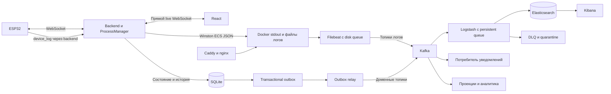

# План интеграции Kafka и логирования через Elasticsearch и Kibana

Дата: 23 ноября 2026 года. Проект: OrangeBrew. Статус: план реализации.

Цель — внедрить Kafka для передачи логов и асинхронных событий OrangeBrew, Elasticsearch для поиска и хранения логов, Kibana для расследований, графиков и оповещений. Сервис на букву K — **Kibana**. По уточнению владельца проекта **Pino, Vector и интеграция с Better Stack подлежат удалению**.

Предлагаемый стек: **Winston с ECS JSON → Filebeat → Kafka → Logstash → Elasticsearch → Kibana**. Управление нагревателем, ПИД-регулятор, аварийная остановка и текущий WebSocket обмен работают по прямому пути. Kafka обслуживает передачу фактов и фоновые задачи.

План охватывает два результата:

1. Основной результат: новый конвейер логирования и полное удаление старой интеграции.
2. Следующий результат: публикация событий процесса через transactional outbox и первый потребитель. Телеметрия и аудит подключаются отдельными этапами после проверки основного конвейера.

Ниже приведены предлагаемые настройки и критерии. Размеры очередей, сроки хранения и пороги оповещений уточняются на первом этапе по измеренной нагрузке.

## 1. Текущее состояние OrangeBrew

| Область | Что есть в коде | Следствие для реализации |
|---|---|---|
| Backend | Node.js, Express, WebSocket, локальная SQLite через better-sqlite3 | Начать с одного владельца состояния управления; Kafka сама по себе не позволяет запустить несколько равноправных backend |
| Устройства | Аутентификация ESP32 по per-device API key, данные по WebSocket | Сохранить текущий протокол; сервер определяет владельца события |
| Управление | ProcessManager на пользователя и прямой путь команд к устройствам | Сетевая отправка в Kafka не входит в ожидание PID и аварийной остановки |
| Логи | Pino и pino-http, JSON stdout, child loggers | Заменить реализацию общего logger и HTTP middleware, сохранить полезные точки логирования |
| Сбор логов | Vector 0.43.1 → Better Stack в test Compose | Удалить сервис, конфигурацию, токен и зависимость CI/CD от Vector |
| Production | В production Compose сборщика логов нет | Подключение production нужно выполнить явно |
| Аудит | SQLite audit_log, writeAudit подавляет ошибки, очистка через 30 дней | Текущий аудит имеет ограниченные гарантии; для надёжной публикации нужна транзакционная запись |
| История температуры | SQLite temperature_log, запись при активном процессе примерно раз в 10 секунд | Сохранить её как историю варки; технические логи имеют отдельное назначение |
| Kafka | Зависимости, broker и consumers отсутствуют | Добавить инфраструктуру, контракты и обработку отказов |

Основание: `backend/server.js`, `backend/utils/logger.js`, `backend/utils/audit.js`, `backend/ws/liveServer.js`, `backend/services/ProcessManager.js`, `backend/db/database.js`, `backend/package.json`, оба Compose и `.github/workflows/deploy-test.yml`.

`docs/MIGRATION_LOGGING.md` описывает прежнюю миграцию console → Pino. Многие её задачи уже реализованы. При внедрении нового решения заменить этот документ актуальной инструкцией перехода.

## 2. Целевая архитектура



Роли компонентов:

- **Winston** формирует структурированные записи; официальный `@elastic/ecs-winston-format` приводит их к Elastic Common Schema. [Документация ECS для Winston](https://www.elastic.co/docs/reference/ecs/logging/nodejs/winston).
- **Filebeat** читает файлы контейнерных логов, хранит позицию чтения и отправляет записи в Kafka.
- **Kafka** буферизует потоки, позволяет независимо читать их разным потребителям и повторять обработку в пределах retention.
- **Logstash** читает Kafka, проверяет и преобразует поля, направляет документы в Elasticsearch и обслуживает поддерживаемые ошибки через DLQ.
- **Elasticsearch** индексирует данные; **Kibana** предоставляет поиск и панели. [Назначение Kibana](https://www.elastic.co/kibana).

Первый рабочий сценарий: выполнить запрос к API, найти его лог в Kibana по request ID и восстановить связанные события по пользователю, устройству и сессии.

## 3. Ограничения и гарантии

1. Backend продолжает принимать показания и выполнять управление при недоступной Kafka или Elasticsearch. Выделить ограниченные очереди и таймауты; исключить сетевой `await` из критического пути.
2. Kafka содержит факты о процессе. Повторное чтение топика не должно включать нагреватель, насос или возобновлять варку.
3. Для логов допускаются повторные записи. Сохранность ограничена доступностью исходных файлов, ёмкостью очередей, дисков и Kafka retention. Проверить эти границы испытаниями.
4. Для сохранённых доменных событий целевая модель — доставка с возможными повторами и идемпотентная обработка. Exactly-once не распространяется автоматически на SQLite, Elasticsearch и Telegram. [Границы гарантий Kafka](https://kafka.apache.org/44/design/design/).
5. При отказе SQLite аварийная остановка сначала выключает оборудование; ошибка записи события не задерживает это действие. В этом случае сохранность самого события ограничена доступными резервными средствами фиксации.
6. Один backend остаётся владельцем локальных ProcessManager, WebSocket подключений и SQLite. Вынос управления на несколько экземпляров требует отдельного проекта владения устройствами и состоянием.

## 4. Замена Pino на Winston

### 4.1. Общий фасад логгера

Переписать `backend/utils/logger.js` на Winston и ECS formatter. Все модули продолжают импортировать общий logger из этого файла. Фасад должен поддержать существующие формы вызова:

- `logger.child({ module, userId, deviceId })`;
- `log.info('message')`;
- `log.info({ sessionId, state }, 'message')`;
- `log.error({ err }, 'message')`;
- `logger.fatal({ err }, 'message')`.

Это контракт приложения без зависимости от Pino. Winston использует другой порядок аргументов; без адаптации часть метаданных потеряется. Задать явные уровни `fatal`, `error`, `warn`, `info`, `debug`, `trace` и проверить фильтрацию. Передавать Error в ECS formatter с сохранением типа и stack trace.

Production выводит одну JSON запись на строку без ANSI цветов и многострочных stack trace. Для локальной разработки допускается читаемый console format. Сохранить `LOG_LEVEL`, `LOG_FORMAT`; добавить отдельный `APP_ENV=test|prod|development`, поскольку NODE_ENV не различает все окружения развёртывания.

Сделать bounded flush при штатном завершении. Для fatal проверить завершение процесса после попытки записи; logger не должен зависать при отказе stdout или добавлять сетевые ожидания.

### 4.2. HTTP логирование

Удалить pino-http и заменить небольшим Express middleware в `backend/middleware/requestLogger.js`:

1. Создать серверный `requestId`; входящий идентификатор принимать только после проверки формата и длины.
2. Возвращать request ID в ответе; добавлять `req.log` и контекст для вложенных вызовов через AsyncLocalStorage либо явную передачу.
3. Записывать одно событие завершения запроса, включая прерванные соединения.
4. Передавать разрешённые поля: метод, очищенный путь, шаблон маршрута, статус, длительность, request ID и серверный user ID.
5. Сохранять обычные запросы на info, 4xx на warn, 5xx и ошибки на error; health checks агрегировать или исключать.
6. Формировать message из очищенных значений. Полевая маскировка не удалит токен, уже вставленный в строку сообщения.

Критерий: request ID связывает HTTP запись, ошибку приложения, изменение процесса и последующее Kafka событие.

## 5. Формат логов и защита данных

Использовать ECS для общих полей и namespace `orangebrew` для предметных полей. [Справочник ECS](https://www.elastic.co/docs/reference/ecs/ecs-field-reference).

```json
{
  "@timestamp": "2026-11-23T10:15:30.123Z",
  "ecs.version": "<зафиксированная версия ECS>",
  "message": "Process step changed",
  "log.level": "info",
  "log.logger": "ProcessManager",
  "service.name": "orangebrew-backend",
  "service.version": "<git sha>",
  "deployment.environment.name": "prod",
  "event.id": "<uuid записи>",
  "event.action": "process.step_changed",
  "user.id": "42",
  "orangebrew.device.id": "device-123",
  "orangebrew.session.id": "456",
  "orangebrew.correlation.id": "<идентификатор цепочки>",
  "orangebrew.process.state": "HOLDING"
}
```

В JSON допустимы ECS dotted keys, но при разборе Filebeat их нужно развернуть в объекты. Для HTTP использовать `http.request.method`, `http.response.status_code`, `url.path`; шаблон маршрута хранить в собственном `orangebrew.http.route`. `event.duration` хранит наносекунды: текущие миллисекунды умножляются на 1 000 000. Ошибки сохраняются в `error.type`, `error.message`, `error.stack_trace`.

`trace.id` и `span.id` заполнять при настоящей трассировке. Request ID и correlation ID хранить отдельно. Стабильный `event.id` логгер создаёт до вывода в stdout; для записи о доменном событии дополнительно передавать его доменный event ID.

Обязательные исправления перед отправкой в новый конвейер:

- В `backend/ws/liveServer.js` убрать сырой `msg.api_key` из записи о неудачной аутентификации. Если нужна корреляция попыток, использовать безопасный fingerprint.
- Очищать `token`, `api_key`, password, authorization, cookies и pairing codes в объектах, URL, message и error message до stdout.
- Учитывать JWT в query string WebSocket клиента. Проверить также proxy access logs и error middleware.
- Не писать полные req/res, тела запросов, Telegram token и конфигурацию секретов. Минимизировать username, email, IP и chat ID согласно назначению диагностики.
- Ограничить `device_log`: например, 8 KiB текста, известные уровни, лимит частоты на устройство и счётчик отброшенных сообщений. Произвольный текст устройства проверяется отдельно от объектных полей.
- Начальный лимит JSON записи — 64 KiB с явной отметкой об усечении; согласовать его с лимитами Filebeat, Kafka и Logstash.

Тест с искусственными секретами должен проверять stdout, Kafka, Elasticsearch и quarantine. Quarantine также хранит потенциально чувствительные данные и требует ограниченного доступа.

## 6. Kafka и структура топиков

### 6.1. Развёртывание

Для dev/test — один broker/controller в KRaft, постоянный volume, явный cluster ID, healthcheck и повторяемый topic bootstrap. Зафиксировать версии образов и совместимость Kafka с Filebeat, Logstash Kafka plugin и Node.js клиентом.

Для отказоустойчивой production схемы — управляемый Kafka либо собственные brokers и controller quorum в независимых доменах отказа. Начальный ориентир: три brokers, три controllers, RF=3, `min.insync.replicas=2`, подтверждение всеми ISR и TLS/SASL. Combined broker/controller подходит для разработки; критические развёртывания требуют разделения ролей. [KRaft и controller quorum](https://kafka.apache.org/44/operations/kraft/).

Три контейнера на одном VPS сохраняют общий отказ хоста. При выборе одного VPS зафиксировать это как ограничение доступности и обеспечить восстановление из сохранённых данных.

### 6.2. Начальные топики

Префикс: `orangebrew.<env>`, где env — test или prod. Значения ниже — стартовая конфигурация для проверки нагрузкой.

| Суффикс топика | Ключ сообщения | Partitions | Retention | Назначение |
|---|---|---:|---:|---|
| `logs.backend.v1` | container ID | 3 | 3 суток | HTTP и backend |
| `logs.device.v1` | server user ID + device ID | 3 | 3 суток | Логи ESP32 |
| `logs.proxy.v1` | host/container ID | 1 | 3 суток | Caddy и nginx |
| `process.events.v1` | user ID + session ID | 3 | 30 суток | Переходы и факты процесса |
| `device.telemetry.v1` | user ID + device ID | 3 | 3 суток | Принятые показания, после отдельного включения |
| `audit.events.v1` | user ID | 1 | 30 суток | Транзакционно сохранённый аудит, после его доработки |
| `logs.quarantine.v1` | исходный ключ при наличии | 1 | 7 суток | Ошибки разбора/контракта логов |
| `process.events.dlq.v1` | исходный ключ | 1 | 14 суток | Ошибки конкретного доменного consumer |

Для dev/test RF=1 и min ISR=1; для HA production RF=3 и min ISR=2. Установить `cleanup.policy=delete` для истории событий и логов. Для log topics использовать `message.timestamp.type=LogAppendTime`, сохранив исходное время внутри JSON. Filebeat иначе может передать старое время Kafka записи, что влияет на retention при replay. [Kafka output Filebeat](https://www.elastic.co/docs/reference/beats/filebeat/kafka-output).

Дополнительно:

- Создавать топики через bootstrap; отключить их автоматическое создание приложением.
- Разделить права и consumer groups для логов, доменных событий, уведомлений и replay.
- Не создавать топик на каждого пользователя и не считать Kafka key механизмом доступа.
- Порядок гарантируется внутри partition. Изменение числа partitions требует плана миграции ключей и проверки sequence.
- Согласовать `retention.bytes`, message limits и producer quotas. Разные топики сами по себе не резервируют диск и CPU; при общем кластере остаётся общий отказ.

## 7. Filebeat вместо Vector

Добавить конфигурации Filebeat для test и prod. Читать только контейнеры OrangeBrew по стабильным labels или проверенной конфигурации autodiscover.

1. Проверить используемый Docker logging driver. Для чтения контейнерных файлов принять `json-file` с явными `max-size` и `max-file`.
2. Использовать `filestream` со стабильным уникальным input ID. Сначала разобрать Docker envelope через container parser, затем JSON приложения через ndjson parser с явным `target: orangebrew_raw`, `expand_keys: true` и `add_error_key: true`. На этапе нормализации в Logstash переносить в корень только разрешённые ECS поля. Конфликты dotted/object keys и ошибок разбора направлять в quarantine; доверенные metadata и routing назначать последними. Проверить параметры parser на закреплённой версии Filebeat.
3. Обрабатывать access logs Caddy/nginx отдельными правилами. Не отправлять их как ошибочно разобранный Winston JSON.
4. Сохранять `path.data`, registry и `queue.disk` на постоянном volume. Размер disk queue ограничить и включить метрики заполнения.
5. Настроить Kafka output с `required_acks: -1`, compression, проверенным client protocol version и лимитом сообщения выше лимита приложения, но ниже broker limit.
6. Назначать topic и environment из доверенной конфигурации после разбора исходного JSON. Запретить исходным полям переопределять доверенные metadata, routing и user/device identity. Поля device_log не могут выбирать произвольный topic или data stream.
7. Не включать собственные ошибки Filebeat/Logstash в бесконечный цикл повторного сбора; на первом этапе сохранять их локально с ротацией и отдельной проверкой здоровья.

У filestream fingerprint по умолчанию ожидает размер файла 1024 байта; проверить появление небольших canary файлов. Выбранные параметры fingerprint и input ID закрепить, поскольку их смена может вызвать повторное чтение. [Filestream input](https://www.elastic.co/docs/reference/beats/filebeat/filebeat-input-filestream).

Disk queue улучшает восстановление после рестарта, но содержит также промежуточные данные в памяти. При заполнении очереди чтение останавливается; Docker rotation может удалить ещё не прочитанные файлы. Рассчитать оба запаса хранения на целевой простой. [Очереди Filebeat](https://www.elastic.co/docs/reference/beats/filebeat/configuring-internal-queue).

На Linux VPS проверить пути и разрешения к контейнерным логам. Для Windows/Docker Desktop подготовить отдельный smoke стенд с доступным NDJSON fixture или проверенными путями Linux daemon. Доступ к Docker API предоставлять только при необходимости metadata discovery и ограничивать его права.

## 8. Logstash и обработка ошибок

Настроить отдельный pipeline логов с group ID `orangebrew-<env>-logs-indexer-v1`:

- Kafka input с JSON codec, явным group ID и `enable_auto_commit=false`.
- `queue.type=persisted`, постоянный локальный volume и ограничение размера PQ.
- Проверить `queue.checkpoint.writes=1` как исходный вариант максимальной устойчивости; измерить цену дисковых операций.
- Проверить обязательные поля, типы, timestamp, допустимый dataset и размеры. Разделить parsing failures, постоянные ошибки документов и временную недоступность destination.
- ECS-совместимый Elasticsearch output в data stream mode; собственные templates и lifecycle provision отдельно, `manage_template=false`.
- Включить локальный Logstash DLQ, ограничить его размер и срок хранения; добавить обработчик исправления и повторной загрузки.

**Важная граница подтверждения:** при `enable_auto_commit=false` Kafka input фиксирует offset после помещения записи во внутреннюю очередь Logstash, включая PQ. Это ещё не подтверждение Elasticsearch. PQ не реплицируется; потеря её диска требует контролируемого повторного чтения сохранённых Kafka сообщений. [Kafka input](https://www.elastic.co/docs/reference/logstash/plugins/plugins-inputs-kafka), [persistent queues](https://www.elastic.co/docs/reference/logstash/persistent-queues).

| Сбой | Действие |
|---|---|
| Elasticsearch недоступен, HTTP 429/5xx | Retry и backpressure; следить за PQ и Kafka lag |
| Документ отвергнут с 400/404 | Поддерживаемая ошибка направляется в DLQ при включённом DLQ |
| Malformed JSON или неверный контракт | Явная ветка в quarantine topic, alarm; встроенный DLQ этого автоматически не решает |
| HTTP 413 | Предотвращать лимитами; согласовать `dlq_custom_codes` и поведение выбранной версии output |
| 409 conflict | Проверить и учитывать как отдельный исход; не считать автоматически повторённым |
| PQ/DLQ близки к лимиту | Alarm, ограничение входящего потока и runbook освобождения ёмкости |

Встроенный DLQ поддерживает определённые ошибки Elasticsearch output и вычисления условий; он не является универсальным перехватчиком всех исключений. Проверять результат по каждому документу bulk запроса. [DLQ](https://www.elastic.co/docs/reference/logstash/dead-letter-queues), [Elasticsearch output](https://www.elastic.co/docs/reference/logstash/plugins/plugins-outputs-elasticsearch).

## 9. Elasticsearch и Kibana

### 9.1. Хранение и lifecycle

Предлагаемые data streams:

| Data stream | Начальный срок | Содержимое |
|---|---:|---|
| `logs-orangebrew.backend-<env>` | 14 суток | API и backend |
| `logs-orangebrew.device-<env>` | 14 суток | Устройства |
| `logs-orangebrew.proxy-<env>` | 14 суток | Reverse proxy и frontend access logs |
| `logs-orangebrew.audit-<env>` | 30 суток | Проекция аудита после отдельного подключения |
| `logs-orangebrew.debug-<env>` | 3 суток | Debug при временном включении |

До запуска ingest подготовить component templates, index templates, mappings, ILM policies и права записи. Filebeat с Kafka output не загружает собственные Elasticsearch templates автоматически; для `logs-orangebrew.*` управлять схемой отдельным bootstrap.

Для малого потока начать с одного primary shard на backing index. Ориентир rollover: до 7 суток либо 20 GiB primary shard; при замере подобрать значения, чтобы не создавать множество мелких индексов. Срок ILM удаления обычно отсчитывается от rollover, поэтому фактическое хранение может быть дольше указанного целевого интервала. Проверить это на тестовой политике. [Data streams](https://www.elastic.co/docs/manage-data/data-store/data-streams), [ILM](https://www.elastic.co/docs/manage-data/lifecycle/index-lifecycle-management).

В single-node test установить replicas=0. Для production с отказоустойчивостью — минимум одна replica с размещением на другом узле; требования к доступности определяют число узлов. Elasticsearch replicas и snapshots решают разные задачи.

Mappings: идентификаторы — keyword, температура и задержки — numeric, timestamps — date. Списки sensor addresses и user IDs хранятся значениями. Произвольный payload — ограниченный flattened или неиндексируемый объект; не создавать поле для каждого адреса датчика.

Ежедневные snapshots хранить отдельно от дисков Elasticsearch. Проверить восстановление в изолированный кластер, включая templates, lifecycle и сохранённые объекты Kibana. Доступ к audit stream ограничить отдельно.

### 9.2. Панели и поиск

Создать data views, сохранённые запросы и панели:

1. **API:** запросы, 4xx/5xx, p50/p95/p99 latency, медленные маршруты.
2. **Устройства:** подключения, отключения, ошибки аутентификации, offline во время активной сессии.
3. **Процесс:** переходы фаз, pause/stop, safety stop, ошибки PID, ошибки сохранения истории.
4. **Приложение:** fatal/restarts, RSS/heap и текущие соединения.
5. **Доставка:** Kafka consumer lag, outbox backlog, возраст старейшего события, PQ/disk queue, DLQ/quarantine, задержка индексации.
6. **Аудит:** действия администраторов и изменения настроек после подключения audit projection.

Минимальные примеры фильтров:

```text
service.name : "orangebrew-backend" and log.level : ("error" or "fatal")
user.id : "42" and orangebrew.session.id : "456"
orangebrew.request.id : "<request-id>"
```

Время события хранить в UTC, отображение Kibana настроить на Europe/Moscow. Для задержки доставки дополнительно хранить время поступления в ingest. Панели по логам могут содержать повторы; критичные количественные метрики собирать отдельными счётчиками.

## 10. Доменные события и transactional outbox

### 10.1. Предварительные исправления

До публикации событий процесса исправить выявленные условия:

- В ProcessManager передавать `this.userId` в `sessionQueries.getById/create/cancel/complete`; сейчас часть вызовов не передаёт владельца.
- В `/api/process/start` проверять принадлежность session, recipe, device и выбранного sensor пользователям из серверного контекста.
- Убрать fallback с фиктивным `sessionId=Date.now()` при отказе БД. Новый процесс запускается после успешного создания принадлежащей пользователю сессии.
- Учитывать SQLite WAL с `synchronous=NORMAL`. Для требований сохранности подтверждённых записей при потере питания оценить `FULL` и измерить задержки.
- Определить сохраняемый snapshot процесса и sequence: существующего счётчика каждосекундных UI update недостаточно для восстановления и порядка доменных переходов.

### 10.2. Контракт события

```json
{
  "eventId": "<uuid, один раз до записи outbox>",
  "eventType": "process.step_changed",
  "schemaVersion": 1,
  "occurredAt": "2026-11-23T10:15:30.123Z",
  "recordedAt": "2026-11-23T10:15:30.125Z",
  "userId": 42,
  "deviceId": "device-123",
  "sessionId": 456,
  "aggregateId": "session:456",
  "aggregateSequence": 12,
  "correlationId": "<request или process correlation id>",
  "causationId": "<предыдущее eventId при наличии>",
  "payload": { "previousStep": 0, "currentStep": 1, "state": "HEATING" }
}
```

Контракты хранить как JSON Schema с примерами. Новые необязательные поля совместимы в пределах версии; несовместимые изменения требуют новой версии и периода миграции consumer. Проверять контракт до outbox и при чтении.

Сервер назначает `userId`, `deviceId` и связь с сессией по аутентифицированному контексту. До появления device boot ID/sequence дедупликация относится к повторной публикации backend, а не ко всем повторам пакетов ESP32. Firmware timestamp хранить отдельно и считать недоверенным.

### 10.3. Транзакции и публикация

Добавить миграцией:

- `event_outbox`: event ID PK, aggregate ID/sequence, topic, key, payload, created/published timestamps, attempts, next attempt, последняя безопасная ошибка;
- `process_runtime_state`: session ID, user ID, snapshot, последний sequence, updated timestamp;
- `processed_events`: consumer name + event ID как уникальный ключ для внутренних идемпотентных эффектов;
- индексы для неопубликованных записей и уникальности sequence внутри aggregate.

Номер миграции выбрать после проверки актуального набора файлов.

Протокол:

1. В одной короткой SQLite транзакции сохранить бизнес-изменение, snapshot и outbox. Сеть внутри транзакции не вызывать.
2. Для старта сначала сохранить `process.start_requested`, затем выполнить прямой переход управления. `process.started` отражает определённый серверный переход; подтверждение оборудования описывать отдельно, если протокол его предоставляет.
3. При падении между сохранённым запросом и командой восстановление показывает незавершённое действие оператору. Автоматически воспроизводить команды оборудованию запрещено.
4. Outbox relay в том же backend читает очередь ограниченными batch, отправляет Kafka и отмечает публикацию после broker ack. Начать с одного relay, сохраняя порядок aggregate и при retry.
5. Падение после Kafka ack до отметки published создаёт повтор с тем же event ID. Это штатный случай.
6. Для внутреннего DB эффекта consumer сохраняет результат и `processed_events` в одной транзакции; offset фиксируется после успешной обработки.
7. Ограничить outbox по объёму и возрасту. При нехватке места отклонять новый старт с понятной причиной, сохранять возможность остановки активного процесса. Не допускать, чтобы телеметрия заняла весь диск SQLite.

Явные события: start requested/started/failed, paused, resumed, step changed/reached, completed, stopped, safety stop. ProcessManager `update` служит также каждосекундному обновлению UI; публиковать каждое такое событие в доменный поток не требуется.

Первый Node.js клиент для проверки — `@confluentinc/kafka-javascript` с promise API. Для relay включить idempotent producer, подтверждение `acks=all`, совместимые ограничения in-flight запросов и bounded retry с backoff/jitter. Идемпотентность producer не заменяет event ID и consumer deduplication при повторной отправке outbox после рестарта. Проверить ESM импорт, Node 22 и текущий Alpine image, обработку доставки, TLS/SASL, reconnect и bounded shutdown; закрепить протестированную версию. [Официальный JavaScript клиент](https://docs.confluent.io/kafka-clients/javascript/current/overview.html).

### 10.4. Потребители

Первым подключить безопасную проекцию событий для проверки outbox, sequence и повторов. Затем переводить уведомления:

- Группа `orangebrew-<env>-notifications-v1`; отдельный consumer lifecycle.
- Устранить глобальный token/chat ID и `global._latestProcessState` в Telegram service; получать настройки и контекст по проверенному user ID.
- Начально consumer может работать внутри того же приложения с локальными query-объектами. Выделение на другой сервер требует внутреннего config API или secret store; не использовать сетевой shared SQLite.
- Ввести expiry для запоздалых уведомлений, ограниченный retry с backoff, обработку rate limit и DLQ после исчерпания попыток.
- Переключать владельца отправки через `NOTIFICATIONS_TRANSPORT=direct|kafka`, исключив двойную отправку старым обработчиком и consumer.
- До накопления событий для перехода ввести общий delivery ledger по event ID и каналу: direct-путь также записывает результат отправки. При cutover дождаться завершения direct in-flight отправок и сохранить границу sequence/offset. Consumer пропускает уже доставленные события, включая свежий backlog; исторические события без известного результата обрабатываются по отдельному решению. Одного expiry и смены флага для этого недостаточно.
- Telegram send и запись результата не составляют общую транзакцию: сбой после успешной отправки может создать повтор. Inbox ограничивает повторную обработку, но не устраняет это окно полностью.
- Replay аналитики не инициирует уведомления пользователям.

После этого подключить sampled telemetry. Для первого режима достаточно одного принятого измерения в 5–10 секунд на устройство; точную частоту выбрать по нуждам аналитики. Непрерывная история варки остаётся в SQLite. Для потока telemetry задать отдельные лимиты и счётчики пропусков.

Audit mirror подключать после определения транзакционных границ. Связать запись audit и outbox одной транзакцией; для полного покрытия действий менять соответствующие бизнес-операции. Текущий best-effort writeAudit сам по себе не гарантирует аудит каждого выполненного действия.

## 11. Безопасность и изоляция окружений

- Kafka, Elasticsearch и ingest endpoints доступны во внутренней сети; внешние соединения защищены TLS и аутентификацией.
- Kibana доступна операторам через защищённый доступ. Разделить роли reader, operator и ingest; bootstrap credentials хранить отдельно от runtime credentials.
- Test и prod имеют разные credentials, Kafka prefixes/groups, data streams и volumes. Для требуемой изоляции отказов использовать отдельные ресурсы.
- Kibana Spaces организуют интерфейс; доступ к данным задаётся правами Elasticsearch. Возможность document/field-level security и оповещений проверить для выбранной лицензии.
- Секреты передавать через установленный secret management; `.env.example` содержит только названия и безопасные примеры.
- Не передавать Telegram token, device API key или JWT в Kafka payload. Потребитель получает необходимые секреты из доверенной конфигурации.
- Удаление пользователя должно учитывать уже опубликованные сообщения, outbox, индексы и сроки хранения. Зафиксировать правила очистки и повторного чтения до подключения audit projection.

## 12. Ресурсы и размеры очередей

Первым этапом измерить RAM/CPU/SSD VPS, свободное место, IOPS, текущие приложения, средний и пиковый поток, размер JSON записи и число устройств. Контейнерные лимиты существующего Compose не определяют свободную ёмкость хоста.

Начальные ориентиры для тестового стенда с небольшой нагрузкой, без обещания достаточности:

| Компонент | Ориентир RAM | Постоянные данные |
|---|---:|---|
| Kafka single node | 2–3 GiB плюс запас page cache | Broker data |
| Elasticsearch single node | 4–6 GiB, heap ориентировочно 2–3 GiB | Индексы |
| Kibana | 1–2 GiB | Сохранённые объекты находятся в ES |
| Logstash | 2–3 GiB, heap 1–2 GiB | PQ и DLQ |
| Filebeat | 128–256 MiB с проверкой нагрузки | Registry и disk queue |

Для совместного пилота планировать хост примерно с 16–24 GiB RAM с учётом ОС и приложения; фактическое размещение решить по замерам. Для HA production составить отдельную смету на несколько хостов или managed services.

Расчётные формулы:

```text
raw_bytes_per_day = events_per_second × average_event_bytes × 86400
kafka_disk = raw_bytes_per_day × retention_days × replication_factor × headroom
buffer_bytes = peak_bytes_per_second × planned_outage_seconds × headroom
es_disk = raw_bytes_per_day × retention_days × measured_index_factor
          × (1 + replica_count) × headroom
```

Пример гипотезы: 20 записей/с по 1 KiB дают около 1,65 GiB сырых данных/сутки. Три дня Kafka с RF3 и запасом 1,3 требуют около 19,3 GiB суммарного места под эти данные. Сжатие может снизить размер; сегменты, индексы и прочие потоки добавляют расход. Коэффициент индексации Elasticsearch измерить, а не принять равным единице.

Зафиксировать исходный тест на 30 минут недоступности Kafka и 60 минут Elasticsearch, затем подобрать очереди по фактическому пику. Kafka retention должен покрывать также восстановление после потери Logstash PQ. Ограничить суммарный объём outbox, Docker logs, queues, Kafka и ES так, чтобы один поток не исчерпал диск приложения.

## 13. Метрики и оповещения

Собирать технические метрики Kafka, Filebeat, Logstash, Elasticsearch и backend через доступные metrics/JMX endpoints и согласованный сборщик. Проверки недоступности самого Elastic выполнять независимым health monitor, поскольку Kibana не отправит надёжный alarm при отказе всей своей инфраструктуры.

Начальные правила для настройки на стенде:

| Сигнал | Исходное правило | Реакция |
|---|---|---|
| Safety stop / fatal | Каждое событие | Немедленный alarm ответственному оператору |
| Устройство offline | Пропуск нескольких интервалов при активной сессии | Alarm с session/device context |
| API 5xx | Более 5% за 5 минут при достаточном числе запросов | Проверка backend и связанного request ID |
| Доставка логов | p95 задержки более 60 секунд за 5 минут | Проверить Kafka lag, PQ и ES |
| Outbox | Старейшее событие более 60 секунд либо растущий backlog | Проверка relay/Kafka, оценка свободного диска |
| DLQ / quarantine | Появление новых записей | Разобрать ошибку контракта/mapping |
| Очереди и диск | 70% warning, 85% critical; согласовать с watermarks ES | Увеличить ёмкость либо снизить входящий поток |
| Collector / indexer / ES | Независимая healthcheck не проходит | Alarm по отдельному каналу |

Для heartbeat учитывать текущий интервал backend около пяти минут. Добавить дедупликацию alarms, ограничение частоты и уведомление о восстановлении. Источник критичных оповещений об оборудовании должен сохранять независимость от Elasticsearch.

## 14. Этапы реализации

Оценка для одного разработчика: **14–23 рабочих дня** для основного конвейера, первого доменного сценария и проверки выбранного production размещения. Это предварительная оценка; закупка ресурсов, отдельное проектирование HA и расширение всех audit/telemetry сценариев оцениваются после этапа 0.

| Этап | Работы | Оценка | Условие завершения |
|---|---|---:|---|
| 0. Требования и ёмкость | Измерить нагрузку/VPS, выбрать topology, версии, retention, outage budget; зафиксировать контракты | 1–2 дня | Есть расчёт диска/RAM и проверяемые пределы восстановления |
| 1. Новый logger | Winston ECS, фасад, request middleware, контекст, маскировка, fatal/shutdown | 2–3 дня | Все основные точки логируют корректный JSON; canary secrets отсутствуют в stdout |
| 2. Инфраструктура | KRaft Kafka, ES/Kibana, bootstrap топиков/templates/ILM/roles, healthchecks и volumes | 2–3 дня | Повторный bootstrap безопасен, сервисы поднимаются с сохранёнными данными |
| 3. Конвейер логов | Filebeat → Kafka → Logstash → ES, PQ/DLQ/quarantine, панели | 2–3 дня | API и device canary находятся в Kibana, сбои доставки диагностируются |
| 4. События процесса | Исправить user scope, session fallback; snapshot, schema, outbox и relay | 2–4 дня | Простой Kafka и restart не теряют сохранённые события; управление работает |
| 5. Первый consumer | Проекция, идемпотентность, refactor Telegram и контролируемый переход уведомлений | 2–3 дня | Повторы обработаны, чужой пользователь не получает данные, expiry/retry работают |
| 6. Эксплуатация и переход | Нагрузка, отказы, snapshots/replay, prod canary, удаление старого стека и документация | 3–5 дней | Пройдена матрица проверок и checklist удаления; есть runbooks |

Этапы 0–3 дают первый проверяемый результат по логированию. После приёмки нового logging конвейера старые компоненты удаляются при ближайшем согласованном развёртывании; работа над доменными событиями не должна задерживать это удаление.

Параллельно можно готовить templates/панели и logger; outbox зависит от исправления сохранения сессий. Перенос уведомлений зависит от устранения глобального Telegram context.

## 15. План изменений по файлам

| Файлы | Изменение |
|---|---|
| `backend/package.json`, `backend/package-lock.json` | Удалить pino/pino-http/pino-pretty; добавить Winston, ECS formatter, выбранный Kafka client и schema validator |
| `backend/utils/logger.js` | Новый независимый фасад на Winston |
| `backend/middleware/requestLogger.js` | Создать HTTP logging middleware |
| `backend/utils/logContext.js`, `backend/utils/redact.js` | Создать контекст и очистку разрешённых полей |
| `backend/server.js` | Заменить HTTP logging, lifecycle relay/consumers, bounded shutdown |
| `backend/middleware/errorHandler.js`, `backend/ws/liveServer.js` | Очистить URL/секреты, ограничить device_log, передавать контекст |
| `backend/services/ProcessManager.js`, `backend/routes/process.js` | Исправить user scope и старт, явные доменные события |
| `backend/services/telegram.js` | Устранить глобальный recipient/state; подготовить consumer |
| `backend/db/database.js`, новая SQL migration | Query-объекты outbox/state/inbox и транзакционные операции |
| `backend/events/schemas/`, `backend/infrastructure/kafka/` | Контракты, client factory, topic definitions |
| `backend/workers/outboxRelay.js`, `backend/consumers/` | Relay и потребители |
| `infra/filebeat/`, `infra/logstash/`, `infra/elastic/`, `infra/kafka/` | Создать конфиги, bootstrap и описания версий |
| `docker-compose.observability.yml`, dev/test profile | Создать инфраструктурное развёртывание; prod topology уточнить на этапе 0 |
| `docker-compose.test.yml`, `docker-compose.prod.yml` | Подключить новые env/labels/rotation; удалить Vector из test |
| `vector.test.toml` | Удалить |
| `.github/workflows/deploy-test.yml`, `deploy-prod.yml` | Заменить доставку конфигов, разделить deploy приложения и stateful инфраструктуры |
| `backend/tests/`, integration smoke scripts | Контракт logger, секреты, outbox, изоляция, доставка и отказы |
| `README.md`, `CLAUDE.md`, `docs/MIGRATION_LOGGING.md` | Обновить описание текущего стека и инструкции эксплуатации |

Stateful инфраструктуру обновлять отдельным шагом с health gates. Текущий deploy-test принудительно пересоздаёт все перечисленные контейнеры; распространение такого поведения на Kafka и ES вызовет ненужные простои. Приложение запускается при временно недоступной observability инфраструктуре и сообщает о деградации отдельно.

## 16. Матрица проверок

| Сценарий | Ожидаемый результат |
|---|---|
| HTTP 200/400/500 и abort | Одна запись завершения на запрос; корректный уровень, статус и request ID |
| Error, child logger, fatal, trace | Контекст и stack сохранены, уровни фильтруются, JSON валиден |
| Искусственные token/API key/password в URL, fields, error/device text | Секрет отсутствует во всех destinations и quarantine |
| JSON пытается переопределить environment/routing или содержит dotted/object collision | Доверенные metadata сохранены; конфликт направлен в quarantine |
| Два пользователя с разными устройствами | Нет чужих сессий, настроек, событий или уведомлений |
| Kafka выключена на 30 минут | Управление и live UI работают; Filebeat/outbox ограниченно накапливают очередь, видна деградация |
| Filebeat restart и Docker rotation | Registry восстанавливается; проверены задержки, повторы и предел потерь при удалении непрочитанных файлов |
| Elasticsearch выключен на 60 минут | PQ/lag растут в рассчитанных пределах; восстановление догоняет поток |
| Crash Logstash около PQ checkpoint | Проверены сохранность очереди и runbook Kafka replay при её потере |
| Невалидный JSON / mapping rejection / oversize | Правильный quarantine/DLQ либо явный drop counter; остальной поток обрабатывается |
| Crash relay после broker ack | Повтор имеет прежний event ID; внутренний consumer effect выполняется один раз |
| Rebalance и медленный consumer | Offset не опережает выполненный эффект; порядок и sequence проверены |
| Telegram timeout / 429 / старое событие | Ограниченный retry, expiry и понятный риск повторной внешней отправки |
| Cutover со свежим backlog событий, уже доставленных direct-путём | Consumer сверяет delivery ledger/границу перехода и повторно их не отправляет |
| Диск почти заполнен / log storm | Alarm, квоты и лимиты срабатывают; остановка оборудования доступна |
| Replay старых сообщений | Отдельная group/destination; оборудование не получает команд, уведомления не рассылаются |
| Retention / rollover / snapshot restore | Данные удаляются по принятой политике, восстановление проверено |
| Нагрузка во время варки | Измерены CPU, RAM, event loop lag и задержка управления относительно baseline |
| SIGTERM | Новые запросы/подключения закрываются, железо переводится в согласованное безопасное состояние, WS закрывается до SQLite; network drain ограничен |

На этапе 0 зафиксировать допустимые задержки. Начальный ориентир: p95 доставки логов до 10 секунд при штатной нагрузке и до 30 секунд под тестовым пиком; отсутствие пропусков дедлайнов управления; изменение p95 управляющего пути не более 10% относительно baseline при достаточной точности измерения.

Запускать существующие backend/frontend проверки и необходимые интеграционные smoke тесты в ходе реализации. Проверки реального оборудования выполнять на тестовом стенде.

## 17. Удаление Pino, Vector и Better Stack

После E2E приёмки на test выполнить отдельный checklist:

- [ ] Удалены прямые зависимости `pino`, `pino-http`, `pino-pretty` и обновлён lockfile. Проверена итоговая dependency tree, включая возможные транзитивные зависимости.
- [ ] Удалены импорты Pino и pino-http middleware. Runtime logger работает на Winston; fatal/HTTP/ошибки/child context сохранены.
- [ ] Удалены сервис Vector, старый image, mounts, environment и `vector.test.toml`.
- [ ] Удалена передача `vector.test.toml` из deploy-test и соответствующие команды/комментарии CI/CD.
- [ ] Остановлен и удалён конкретный legacy контейнер `orangebrew-vector-test`. Удаление сервиса из YAML и обычный compose up могут оставить orphan container.
- [ ] Удалены `BETTERSTACK_TOKEN`, старый ingest endpoint и настройки из конфигов развёртывания, secret store и VPS environment; source token отозван после проверки перехода.
- [ ] Отключены старые Better Stack dashboards, alerts и Logs-to-Metrics, которые относятся к удаляемой интеграции.
- [ ] Актуальные инструкции, README и архитектурные заметки направляют оператора в Kibana; исторические записи помечены как завершённые/устаревшие.
- [ ] Подтверждено отсутствие исходящего трафика старого collector и корректная доставка новых canary логов.

Операции с контейнером адресовать точно. Volumes SQLite и нового стека сохраняются. Политику оставшихся исторических данных Better Stack определить отдельно по сроку их полезности и хранения.

## 18. Переход, восстановление и откат

1. Поднять новый стек в test с изолированными credentials, topics и data streams. Сначала проверить fixture логов, затем backend и ESP32 canary.
2. Пройти тесты формата, секретов, восстановления очередей и минимальные нагрузочные проверки.
3. Развернуть Winston и Filebeat для выбранного окружения, проверить контрольные event IDs на всех участках; отключить и удалить старую отправку по checklist.
4. Подключить outbox с capture включённым, но потребителем внешних эффектов выключенным. Сверить event ID/sequence с SQLite.
5. Включить безопасную проекцию. Перед переключением notification transport проверить общий delivery ledger, завершить direct in-flight отправки и сохранить границу перехода; затем включить единственного владельца отправки в новом режиме.
6. Проверить production canary в течение 24–48 часов и завершить приёмку по измеренным показателям.

Флаги приложения определить явно: `EVENTS_CAPTURE_ENABLED`, `KAFKA_PUBLISH_ENABLED`, `NOTIFICATIONS_TRANSPORT`. Отключение publisher сохраняет уже записанный outbox. Отключение capture означает прекращение записи новых событий и требует отдельного осознанного решения.

Варианты восстановления:

- **Elasticsearch недоступен:** сохранять поток в Kafka/PQ, восстановить ES и проверить backlog. Размеры очередей и retention определяют доступное окно.
- **Потеря PQ:** остановить соответствующее чтение, сохранить позиции и выбрать Kafka диапазон; replay выполнять отдельной group в recovery destination. Не сбрасывать offsets рабочей группы без разбора.
- **Ошибка mapping:** исправить template/transform, выгрузить DLQ/quarantine в контролируемую повторную обработку, сверить количество и контрольные IDs.
- **Дефект нового consumer:** выключить consumer/publisher по необходимости, сохранить outbox и offsets, восстановить предыдущую проверенную сборку с совместимыми схемами.
- **Дефект логирования:** оставить ротацию локальных JSON логов и поставить исправленную Winston сборку. Для отката подготовить предыдущую проверенную сборку нового конвейера; удалённые Pino/Vector/Better Stack не являются штатным fallback.

Стабильный event ID помогает находить дубликаты. Один document ID в Elasticsearch data stream не обеспечивает дедупликацию между backing indices после rollover; для обычных логов повторы принимаются, для доменных эффектов используется собственная идемпотентность.

## 19. Условия завершения интеграции

Интеграция завершена, когда лог запроса и устройства находится в Kibana по идентификаторам, новый поток переживает согласованные простои и рестарты, секреты не попадают в destinations, управление выдерживает нагрузку и отказы, а Pino/Vector/Better Stack удалены из рабочего развёртывания.

Для доменной части дополнительно обязательны корректный user scope, транзакционный outbox, проверенные повторы и порядок, работоспособный первый consumer и безопасный replay. Для эксплуатации нужны инструкции: запуск/обновление, поиск ошибки, outage Kafka/ES, переполнение диска, обработка DLQ, восстановление snapshot и повторное чтение Kafka.

До начала production этапа фиксируются измеренная ёмкость VPS, выбранная topology доступности, версии компонентов, сроки хранения и получатели оповещений. Эти решения входят в этап 0 и не мешают начать подготовку logger, контрактов и тестового стенда.
