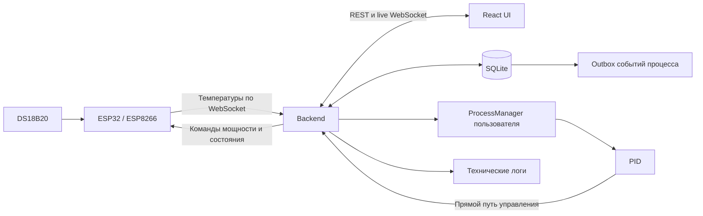
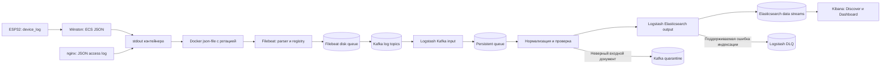
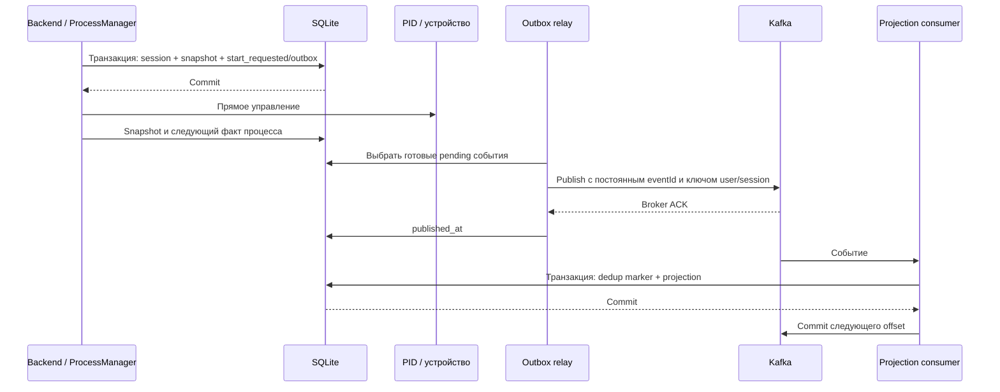

# OrangeBrew: проект, Kafka и путь логов до Kibana

Актуально на **24 ноября 2026 года** для ветки `codex/kafka-elastic-logging`. Документ описывает код этой ветки. Его наличие в GitHub само по себе не означает, что этот код уже развёрнут на VPS.

Это руководство объясняет устройство проекта и помогает проследить конкретную запись от вызова logger до поиска в Kibana. Для provisioning, production-настроек и восстановления используется [runbook](OBSERVABILITY_RUNBOOK.md); результаты испытаний находятся в [отчёте реализации](KAFKA_ELASTIC_IMPLEMENTATION.md). Первоначальные решения сохранены в [плане](KAFKA_ELASTIC_KIBANA_PLAN.md).

## Содержание

1. [Проект](#1-проект)
2. [Два потока через Kafka](#2-два-потока-через-kafka)
3. [Формирование логов](#3-формирование-логов)
4. [Поля и идентификаторы](#4-поля-и-идентификаторы)
5. [Filebeat и отправка в Kafka](#5-filebeat-и-отправка-в-kafka)
6. [Топики, partitions, offsets и группы](#6-топики-partitions-offsets-и-группы)
7. [Logstash и Elasticsearch](#7-logstash-и-elasticsearch)
8. [События процессов и outbox](#8-события-процессов-и-outbox)
9. [Хранение и границы доставки](#9-хранение-и-границы-доставки)
10. [Настройки и режимы](#10-настройки-и-режимы)
11. [Запуск test-стенда](#11-запуск-test-стенда)
12. [Просмотр в Kibana](#12-просмотр-в-kibana)
13. [Практика: найти один HTTP-запрос](#13-практика-найти-один-http-запрос)
14. [Наблюдение за каждым звеном](#14-наблюдение-за-каждым-звеном)
15. [Поиск неисправностей](#15-поиск-неисправностей)
16. [Карта исходного кода](#16-карта-исходного-кода)
17. [Что проверено и что требует приёмки](#17-что-проверено-и-что-требует-приёмки)

## 1. Проект

OrangeBrew — IoT-платформа для автоматизации пивоварения и работы с технологическими процессами. Устройства ESP32/ESP8266 передают температуры DS18B20, сервер рассчитывает управление нагревателем и ведёт процесс, а веб-интерфейс показывает текущее состояние, рецепты и историю сессий. В репозитории также есть разделы ферментации, дистилляции, ректификации, администрирования и SQL Trainer; наличие страницы не означает одинаковую полноту автоматизации всех режимов.

| Часть | Задача | Основные технологии |
|---|---|---|
| Веб-интерфейс | Рецепты, выбор устройства/датчиков, управление и графики | React, Vite, React Router, Recharts |
| Backend | REST API, аутентификация, live WebSocket, владение состоянием | Node.js 22 в Docker, Express, `ws`, JWT |
| ProcessManager | Шаги процесса, пауза/остановка, сохранение переходов | Отдельный экземпляр на пользователя |
| PID | Управление мощностью, фильтрация температуры, автотюнинг | `PidManager`, `PidController`, Kalman filter |
| Данные | Пользователи, устройства, рецепты, сессии, история, outbox | SQLite / better-sqlite3, WAL, миграции |
| Оборудование | Измерения и исполнение команд | ESP32 / ESP32-C3 / ESP32-S3 / ESP8266, Wi-Fi WebSocket |
| Симуляция | Проверки без физического оборудования | `CONNECTION_TYPE=mock`, MockSerial |
| Уведомления | Отправка сообщений владельцу процесса | Telegram, direct или Kafka transport |
| Наблюдение | Поиск логов, расследования, технические графики | Winston, Filebeat, Kafka, Logstash, Elasticsearch, Kibana |



Данные принадлежат пользователям: устройства, рецепты, сессии и настройки связываются с `user_id`. Устройство аутентифицируется собственным API key; пользователь — JWT. Сервер определяет владельца сообщения, а не доверяет переданному устройством `userId`.

Multi-tenant означает изоляцию пользователей. Текущая архитектура управления сохраняет **один backend — владелец локальных ProcessManager, подключений устройств и SQLite**. Несколько Kafka consumers не превращают управление оборудованием в систему из нескольких равноправных backend.

ПИД-регулятор, остановка оборудования и live WebSocket используют прямой путь. Доступность Kafka или Elasticsearch влияет на фоновые потоки и диагностику, а не становится сетевым условием выполнения каждой команды управления.

## 2. Два потока через Kafka

| Поток | Что передаётся | Кто отправляет в Kafka | Кто читает | Где смотреть результат |
|---|---|---|---|---|
| Технические логи | HTTP-запрос, ошибка, подключение устройства, heartbeat | Filebeat после чтения Docker logs | Logstash | Elasticsearch / Kibana |
| Доменные события | Факт запуска, смены шага, паузы, остановки процесса | Backend outbox relay после записи в SQLite | Projection consumer и, при включении, notification consumer | SQLite, `/api/admin/observability`, Telegram, диагностические логи consumers |

Основной конвейер логирования:



Kibana запрашивает **Elasticsearch**. Она не читает Kafka topics напрямую. Событие из `process.events.v1` также не попадает автоматически в Elasticsearch: для него сейчас работают отдельные потребители, а Logstash подписан на топики логов.

`KAFKA_PUBLISH_ENABLED=false` выключает **доменный publisher backend**. При этом Winston → Docker → Filebeat может продолжать доставлять логи, если infrastructure stack запущен и контейнер имеет нужные labels.

## 3. Формирование логов

### 3.1. Backend и Winston

Общий фасад находится в [`backend/utils/logger.js`](../backend/utils/logger.js). Модули пишут через него:

```javascript
import logger from './utils/logger.js'; // путь относительно модуля

const log = logger.child({ module: 'Example' });
log.info({ userId: 42, sessionId: 101 }, 'Process state inspected');
log.error({ err: new Error('Synthetic example') }, 'Operation failed');
```

Фасад сохраняет привычный для приложения порядок `metadata, message`, а внутри вызывает Winston и ECS formatter. `child()` задаёт поля модуля/контекста. Поддерживаются уровни `fatal`, `error`, `warn`, `info`, `debug`, `trace`.

При `LOG_FORMAT=json` либо `NODE_ENV=production` каждая запись выводится **одной JSON-строкой**. Переносы внутри stack trace кодируются в JSON. В читаемом dev-формате строка удобна человеку, но для Filebeat требуется JSON. В test/prod Compose `LOG_FORMAT=json` задан явно.

Logger добавляет время, уровень, модуль, идентификатор записи, dataset, имя сервиса, окружение и версию сборки. `SERVICE_VERSION` позволяет связать ошибку с версией кода; если значение не передано, используется значение по умолчанию, а не автоматически вычисленный Git SHA.

Перед stdout очищаются известные credential fields и текстовые шаблоны секретов. Полные `req`, `res`, headers и body не включаются. У `Error` сохраняются очищенные type/message/stack. Произвольный чувствительный текст всё равно следует исключать в месте вызова logger: маскировка работает по известным правилам.

Ограничения защищают backend от неконтролируемого роста логирования:

- итоговая JSON-запись — до 64 KiB, текст/строки проходят отдельное ограничение;
- очередь ожидающих stdout-записей — до 1024; дальнейшие записи учитываются как dropped;
- `getStats()` возвращает `pending`, `dropped`, `failed`;
- bounded `flushLogs()` ожидает завершения записи в stdout. Это ещё не подтверждение доставки в Kafka или Elasticsearch.

### 3.2. HTTP-запрос

[`requestLogger.js`](../backend/middleware/requestLogger.js) выполняет следующие действия:

1. Проверяет `X-Request-ID`: 1–128 символов, первый — буква/цифра, остальные — буквы, цифры, `.`, `_`, `-`. При отсутствии/неверном формате создаёт UUID.
2. Возвращает `X-Request-ID` в ответе и назначает `req.id` / `req.log`.
3. Запускает AsyncLocalStorage context с request ID и correlation ID. Первоначально они равны; auth middleware добавляет серверный user ID.
4. По завершении пишет один completion log: method, status, path без query string, duration, action, идентификаторы. `event.duration` измеряется **в наносекундах**.
5. Для 4xx выбирает `warn`, для 5xx — `error`. Прерванное соединение получает диагностический статус 499.

`/health` и `/api/health` исключены из completion logs. Поэтому обычная проверка health не подходит для демонстрации поиска HTTP-записи в Kibana.

### 3.3. Лог устройства

ESP32 отправляет сообщение `device_log` по аутентифицированному WebSocket. Backend назначает владельца и device ID из соединения, очищает текст и передаёт его в тот же Winston. Поэтому `service.name` остаётся `orangebrew-backend`, а `event.dataset` становится `orangebrew.device`.

Текст ограничен 8 KiB; принимается до 20 сообщений за 10 секунд на device ID. Уровни устройства: `info`, `warn`, `error`, `debug`; неизвестный уровень заменяется на `info`. Предупреждение о превышении лимита появляется при первом сообщении следующего окна.

`Serial.println()` сам по себе остаётся выводом платы. Для серверного лога прошивка должна отправить `device_log` через предусмотренный механизм логирования.

### 3.4. nginx и Caddy

В текущем ingest dataset `proxy` означает **nginx контейнера frontend**. Он пишет JSON access log с методом, `$uri` без query, HTTP status и duration. Native stderr может содержать исходный URI, поэтому Filebeat оставляет его только в локальных Docker logs.

Все nginx access records имеют `log.level=info`, включая ответы 500. Ошибки proxy нужно искать по `http.response.status_code`, а не только по уровню. nginx также пока не добавляет request ID / event ID, поэтому автоматическая связь его access-записи с backend-записью отсутствует.

Caddy маршрутизирует `/auth`, `/api`, `/ws` к backend и остальные запросы к frontend. Его host access logs в этот collector не подключены.

## 4. Поля и идентификаторы

Пример исходной stdout-записи HTTP, отформатированный для чтения. Идентификаторы и значения демонстрационные; в реальности это одна строка:

```json
{
  "@timestamp": "2026-11-24T09:12:30.123Z",
  "ecs.version": "8.10.0",
  "log.level": "info",
  "log.logger": "HTTP",
  "message": "GET /api/process/status 200",
  "service.name": "orangebrew-backend",
  "service.version": "example-build",
  "deployment.environment.name": "test",
  "event.id": "5c21de84-130d-42ac-938e-9dd09d52fb5d",
  "event.dataset": "orangebrew.backend",
  "event.action": "http.request_completed",
  "event.duration": 12500000,
  "http.request.method": "GET",
  "http.response.status_code": 200,
  "url.path": "/api/process/status",
  "user.id": "42",
  "orangebrew.request.id": "request-demo-42",
  "orangebrew.correlation.id": "request-demo-42"
}
```

`12500000` ns = **12,5 ms**. Dotted keys — нормальный исходный формат ECS Winston. После нормализации Elasticsearch хранит вложенные объекты, например `"log":{"level":"info","logger":"HTTP"}`. В Kibana имена полей по-прежнему отображаются как `log.level`, `orangebrew.request.id` и т. п.

| Поле | Смысл и способ применения |
|---|---|
| `@timestamp` | Время исходного события; основной time field data view |
| `event.ingested` | Время обработки Logstash; добавляется позднее |
| `orangebrew.ingestion_delay_ms` | Разница ingest/source time в ms, ограниченная снизу нулём; включает влияние рассинхронизации часов |
| `event.id` | UUID **одной записи лога** Winston; ищет конкретный документ |
| `orangebrew.request.id` | Связывает логи конкретного HTTP-запроса; возвращается клиенту в `X-Request-ID` |
| `orangebrew.correlation.id` | Связывает связанные операции, если контекст передан дальше; для HTTP начинается с request ID |
| `user.id` | Владелец, определённый сервером; в Elasticsearch — keyword |
| `orangebrew.device.id` | Конкретное устройство |
| `orangebrew.session.id` | Сессия варки/процесса, когда вызывающий код её передал |
| `log.logger` | Модуль: `HTTP`, `ESP32`, `WS`, `ProcessManager`, `OutboxRelay`, `KafkaConsumer`, `Health` и др. |
| `event.dataset` | Логический поток: backend, device, proxy или debug |
| `service.version` | Метка развёрнутой сборки из environment |
| `container.id` | Контейнер-источник из доверенных collector metadata |
| `data_stream.*` | Назначенное Logstash направление индексации |
| `orangebrew.context` | Оставшиеся разрешённые custom metadata в типе `flattened` |

Это не распределённая трассировка OpenTelemetry. Контекст связывает записи там, где код действительно его передаёт; поле session/device не обязано присутствовать у каждого HTTP-запроса. После нахождения request ID при необходимости переходят к session/device ID или domain correlation ID.

`eventId` доменного события — другой идентификатор, чем `event.id` технического лога. У повтора domain event ID сохраняется; у отдельного нового сообщения logger будет новый UUID.

При нормализации действует allowlist. Например, исходные `event.outcome`, `orangebrew.causation.id`, признаки `orangebrew.log.truncated/dropped` и device uptime сейчас не переносятся в итоговый документ. Наличие поля в `docker logs` ещё не означает наличие такого же поля в Kibana. Полный контракт преобразования — [`normalize.rb`](../infra/logstash/normalize.rb).

## 5. Filebeat и отправка в Kafka

### 5.1. Выбор контейнеров

Filebeat подключён к Docker socket и host directory `/var/lib/docker/containers` read-only. Autodiscover запускает input для контейнера, у которого одновременно заданы:

```yaml
labels:
  orangebrew_collect: "true"
  orangebrew_env: test
  orangebrew_service: backend
```

`orangebrew_env` должен совпадать с `APP_ENV` collector. У frontend nginx `orangebrew_service=proxy`. Сами Filebeat, Kafka, Logstash и Elasticsearch такими labels не помечаются, что исключает самосбор в цикле.

### 5.2. Чтение и разбор

1. Docker `json-file` сохраняет stdout/stderr в `/<container-id>/<container-id>-json.log` внутри своего host log directory.
2. Container parser Filebeat снимает Docker envelope (`log`, `stream`, `time`).
3. NDJSON parser разбирает JSON приложения в `orangebrew_raw`.
4. Collector добавляет `orangebrew_source.environment/service/container_id` из своей конфигурации и Docker metadata.
5. Registry хранит позицию чтения; disk queue буферизует подготовленные события на persistent volume.

Плоские dotted keys внутри `orangebrew_raw` могут сохраниться даже при `expand_keys`; Logstash умеет корректно разбирать как эту форму, так и вложенную. Конфликт вроде `"log.level":"warn"` вместе с `"log":{"level":"info"}` отправляется в quarantine.

Дисковая очередь Filebeat ограничена **1 GiB**. Input ограничивает сообщение 128 KiB; Kafka output — 256 KiB. Для filestream настроен fingerprint длиной 64 bytes. Эти ограничения дополняют, а не заменяют ограничение самого Winston.

### 5.3. Публикация

| Условие | Kafka topic в test |
|---|---|
| Backend по умолчанию | `orangebrew.test.logs.backend.v1` |
| `orangebrew_source.service=proxy` | `orangebrew.test.logs.proxy.v1` |
| Device dataset в исходной записи | `orangebrew.test.logs.device.v1` |

Filebeat использует **container ID как Kafka key** для всех этих потоков. Его key не равен user/session/device ID. Настроены gzip, batch до 256 и `required_acks=-1` — ожидание подтверждения от всех текущих in-sync replicas. В single-node test это подтверждение одного broker; production RF3/min ISR2 задаёт другую устойчивость.

Чтение строки Filebeat, подтверждение Kafka и появление документа в поиске — отдельные моменты времени. При недоступной Kafka очередь растёт, затем сбор замедляется. При продолжительном простое Docker rotation может удалить ещё не прочитанный файл.

## 6. Топики, partitions, offsets и группы

**Topic** — именованный поток. Он делится на **partitions** — упорядоченные журналы. **Offset** — позиция сообщения внутри одной partition. Kafka сохраняет данные до истечения retention/лимита размера, а чтение consumer не удаляет сообщение.

**Consumer group** хранит собственный прогресс. Несколько consumers одной группы делят partitions; разные группы могут независимо прочитать те же данные. Порядок обеспечивается внутри partition, а не между всеми сообщениями всех partitions. Проверить порядок обработки доменных фактов дополнительно помогает `aggregateSequence`.

Фактическая test-конфигурация [`topics.sh`](../infra/kafka/topics.sh):

| Суффикс после `orangebrew.test.` | Partitions | Retention | Использование сейчас |
|---|---:|---:|---|
| `logs.backend.v1` | 3 | 3 суток | Winston backend |
| `logs.device.v1` | 3 | 3 суток | Логи устройств через backend |
| `logs.proxy.v1` | 1 | 3 суток | nginx stdout access logs |
| `logs.quarantine.v1` | 1 | 7 суток | Невалидные входные документы Logstash |
| `process.events.v1` | 3 | 30 суток | Доменные факты процесса из outbox |
| `process.events.dlq.v1` | 1 | 14 суток | Необработанные доменные события |
| `device.telemetry.v1` | 3 | 3 суток | Топик подготовлен; отдельный producer не включён |
| `audit.events.v1` | 1 | 30 суток | Топик подготовлен; audit mirror не включён |

Также задан предел **5 GiB на каждую partition**, а не на topic или весь кластер. Удержание заканчивается по времени либо размеру. Test использует RF1/min ISR1 и запрещает автоматическое создание topics.

Kafka timestamp установлен в `LogAppendTime`: это время приёма broker. Исходный `@timestamp` остаётся внутри JSON и используется в Elasticsearch. Retention Kafka поэтому не зависит от старого timestamp внутри тела replay-сообщения.

Повторное чтение уже сохранённого Kafka record не обновляет его timestamp и не продлевает retention. Новое broker время появляется при **повторной публикации** — новом append, даже если body/event ID сохранены прежними.

Рабочие группы test:

| Группа | Назначение |
|---|---|
| `orangebrew-test-logs-indexer-v1` | Logstash, читает три log topics |
| `orangebrew.test.process-projection-v1` | Backend projection consumer |
| `orangebrew.test.notifications-v1` | Backend notification consumer при Kafka transport |

В названиях есть и дефисы, и точки: команды нужно копировать буквально. Группа уведомлений появляется только при её фактическом запуске. Для ручного просмотра используется отдельный consumer; рабочую group indexer/notifications для этого не назначают.

## 7. Logstash и Elasticsearch

### 7.1. Получение и persistent queue

Kafka input Logstash подписан на backend/device/proxy log topics. Он работает в группе `orangebrew-<env>-logs-indexer-v1`, с `enable_auto_commit=false` и `auto_offset_reset=earliest` для отсутствующего сохранённого прогресса.

В этой конфигурации offset подтверждается **при помещении сообщения во внутреннюю очередь Logstash**, а не после Elasticsearch ACK. Очередь — persistent, до 1 GiB, с checkpoint каждой записи. После подтверждения Kafka и до успешной индексации сохранность зависит от volume PQ. Это локальное хранилище без репликации. [Семантика Kafka input](https://www.elastic.co/docs/reference/logstash/plugins/plugins-inputs-kafka).

### 7.2. Нормализация

`normalize.rb` проверяет source/environment, JSON, message, timestamp, level и неоднозначные ECS paths. Затем формирует новый документ:

- сохраняет разрешённые IDs, HTTP/error fields, duration и текст;
- задаёт service, окружение и маршрутизацию из доверенной конфигурации;
- добавляет `event.ingested`, `container.id` и ingestion delay;
- помещает разрешённые прочие metadata в ограниченный `orangebrew.context`;
- сохраняет выбранные heartbeat-значения как числовые `orangebrew.metrics.*`.

Маршрут в Elasticsearch:

| Запись | Data stream |
|---|---|
| Backend info/warn/error/fatal | `logs-orangebrew.backend-test` |
| Device info/warn/error | `logs-orangebrew.device-test` |
| nginx access | `logs-orangebrew.proxy-test` |
| Backend или device debug/trace | `logs-orangebrew.debug-test` |

Debug имеет отдельный data stream, но отдельного Kafka debug topic сейчас нет. Значения `test` заменяются на согласованный `APP_ENV`.

### 7.3. Индексация, quarantine и DLQ

Bootstrap заранее создаёт data streams, mappings, ILM и пользователей. Значения `constant_keyword` для dataset/namespace задаются во время bootstrap, чтобы первая запись не требовала автоматической смены mappings от ingest-пользователя.

Logstash использует отдельного `orangebrew_ingest` с `create_doc` и `view_index_metadata`, действие `create`, проверку CA и HTTPS. `manage_template=false`: runtime не управляет шаблонами. Mapping `dynamic:false` не создаёт произвольные индексируемые поля из входного JSON.

Data stream объединяет backing indices: физические индексы вида `.ds-logs-orangebrew.backend-test-...`. Для поиска используют имя data stream/data view; переключением backing index при rollover управляет Elasticsearch.

| Механизм | Куда попадает запись | Что это означает |
|---|---|---|
| Quarantine | Kafka `logs.quarantine.v1` | Входной payload не прошёл normalizer; причина сохраняется в `orangebrew_quarantine.reason` |
| Logstash DLQ | Файлы на `logstash-data` volume | Поддерживаемая ошибка Elasticsearch output, например per-document 400/404; настроен также HTTP 413 |
| Process DLQ | Kafka `process.events.dlq.v1` | Доменный consumer не смог обработать событие/схему после своей политики попыток |

Это три разных места. Они автоматически не отображаются одной таблицей в Kibana. Quarantine не читается тем же log input обратно; replay выполняется контролируемо после разбора причины. Сетевой отказ Elasticsearch обычно вызывает повторные попытки и backlog, а не перенос каждого сообщения в DLQ.

## 8. События процессов и outbox

Доменные события описывают факты: `process.start_requested`, `process.started`, `process.paused`, `process.step_changed`, `process.completed`, `process.stopped`, `process.safety_stop` и другие типы из [JSON Schema](../backend/events/schemas/process-event.v1.json). Это не команда повторно включить оборудование.



Outbox записывается атомарно с изменением состояния. Relay опрашивает его по умолчанию раз в секунду, выбирает до 50 готовых записей, сохраняет порядок одного aggregate и ожидает delivery acknowledgement. При отказе событие остаётся pending, с нарастающим интервалом повтора от 1 до 60 секунд.

Envelope содержит `eventId`, `eventType`, `schemaVersion`, `occurredAt`, `recordedAt`, `userId`, `deviceId`, `sessionId`, `aggregateId`, `aggregateSequence`, `correlationId`, `causationId`, `payload`. Aggregate имеет форму `session:<sessionId>`, например `session:101`. Kafka key outbox имеет другой формат — `${userId}:${sessionId}`, например `42:101`: он группирует события сессии и отличается как от aggregate ID, так и от container key технических логов.

Возможен crash между broker ACK и записью `published_at`. Тогда relay отправит тот же event ID ещё раз. Projection consumer выполняет dedup marker и DB effect одной транзакцией в `processed_events` / `process_event_projection`. Offset подтверждается после эффекта либо после broker-acked записи в process DLQ.

По умолчанию `NOTIFICATIONS_TRANSPORT=direct`. При `kafka` уведомления читает отдельная группа. Оба режима используют `notification_delivery`; ownership, lease и expiry уменьшают риск повторных/устаревших отправок. Telegram send и SQLite commit не атомарны: crash после успешной внешней отправки может дать повтор.

После перезапуска незавершённые snapshots помечаются для восстановления. UI затирания/кипячения требует подтверждения остановки; сохранённые события не воспроизводят команды нагревателю автоматически.

Температурная история `temperature_log`, SQLite `audit_log`, технические логи и domain events имеют разные задачи. Наличие telemetry/audit topic ещё не означает, что туда уже публикуются данные или что они доступны в Kibana.

## 9. Хранение и границы доставки

| Где находится запись | Ограничение по умолчанию | Что учитывать |
|---|---|---|
| Очередь Winston | 1024 ожидающих записи | При переполнении растёт `logger.dropped` |
| Docker logs backend | 20 MiB × 10 файлов | Ротация ограничивает исходный материал для Filebeat |
| Docker logs frontend nginx | 10 MiB × 5 файлов | stderr остаётся только здесь |
| Filebeat registry/disk queue | Persistent volume, queue 1 GiB | Позиция чтения и очередь переживают пересоздание контейнера при сохранённом volume |
| Kafka log topics | 3 суток и до 5 GiB на partition | Данные могут исчезнуть по более раннему из ограничений |
| Kafka quarantine | 7 суток | Отдельный поток для разбора невалидных документов |
| Logstash PQ | 1 GiB | Локальная очередь, необходимая после Kafka offset commit |
| Logstash DLQ | 256 MiB, retention 7 суток | Отдельная очередь на общем с PQ volume `logstash-data`; поддерживает определённые ошибки output |
| Pending outbox | 100 000 событий / 64 MiB payload | Pending записи не очищаются по TTL; часть ёмкости резервируется активным процессам |
| Published outbox | Очистка старше 24 часов | После broker ACK; это не retention Kafka |

Для Elasticsearch настроен rollover через 7 суток или при 20 GiB primary shard. Delete phase: backend/device/proxy — 14 суток, debug — 3, audit — 30. Отсчёт delete phase связан с rollover, поэтому это **не жёсткая граница возраста каждого документа**. [Семантика ILM min_age](https://www.elastic.co/docs/reference/elasticsearch/index-lifecycle-actions/ilm-rollover).

Технические логи допускают повторы: повторная отправка/чтение может создать ещё один документ с тем же `event.id`. Одно только поле event ID не задаёт exactly-once, особенно после rollover. Для доменных DB effects отдельно реализована идемпотентность consumer; внешняя отправка Telegram имеет описанное окно повтора.

Растущие очереди дают время восстановить систему, но не бесконечное хранилище. Сохранность ограничена исходными файлами, ёмкостью дисков/очередей, retention и доступностью volumes. Kafka lag, PQ и возраст outbox нужно наблюдать совместно.

## 10. Настройки и режимы

### 10.1. Что включается отдельно

| Переменная | По умолчанию | Назначение |
|---|---|---|
| `APP_ENV` | Из env / NODE_ENV | `development`, `test`, `prod`; согласовать с labels, topics, namespaces |
| `LOG_FORMAT` | Зависит от запуска | Для collector использовать `json` |
| `LOG_LEVEL` | `info` в JSON, `debug` в readable mode | Фильтр в backend: отфильтрованной записи дальше уже нет |
| `SERVICE_VERSION` | `development` у logger | Версия сборки; Compose может передать своё значение |
| `EVENTS_CAPTURE_ENABLED` | `true` | Запись domain events в SQLite outbox |
| `KAFKA_PUBLISH_ENABLED` | `false` | Публикация domain events relay и запуск соответствующих consumers |
| `PROCESS_PROJECTION_ENABLED` | `true` | Разрешает projection consumer при включённой Kafka-публикации |
| `NOTIFICATIONS_TRANSPORT` | `direct` | `direct` или `kafka` для уведомлений |
| `NOTIFICATION_TTL_MS` | `900000` | 15 минут актуальности уведомления |
| `KAFKA_BROKERS` | Пусто | Обязателен для включённого domain publisher |
| `KAFKA_DELIVERY_TIMEOUT_MS` | `10000` | Срок native Kafka delivery; влияет также на бюджет остановки backend |
| `FILEBEAT_SMOKE_ENABLED` | `false` | Дополнительный fixture input для smoke-проверки |

`NOTIFICATIONS_TRANSPORT=kafka` требует включённых capture и publisher. Базовый test backend использует `APP_ENV=test`, JSON stdout и mock-оборудование. Без Kafka overlay его domain publisher по умолчанию выключен; Filebeat при этом всё равно может читать его Docker logs.

Полный список outbox, TLS/SASL и остальных параметров: [`backend/.env.example`](../backend/.env.example), [test infrastructure example](../.env.observability.example), [production example](../.env.observability.production.example). Значения `REPLACE_...` — placeholders для документации.

### 10.2. Test и production

| Test Compose | Production |
|---|---|
| Один Kafka broker/controller, RF1/min ISR1 | Отдельно provisioned Kafka, план RF3/min ISR2, ACL/quotas |
| Kafka plaintext только внутри private Docker network | TLS/SASL и отдельные principals |
| Один Elasticsearch node, replicas=0 | Отдельный кластер, replicas, snapshots и capacity planning |
| Локальный CA и TLS для ES/Kibana | Управляемые сертификаты и secret management |
| Готовый стенд для проверки реализации | Collector/indexer конфигурации подключаются к подготовленным сервисам |

Kafka 9092 не опубликован на host test-стенда. Backend, запущенный обычным `node server.js` на host, не сможет использовать Docker DNS `kafka:9092`; для этого сценария предназначен Compose overlay с общей сетью.

Production инструкции находятся в [runbook](OBSERVABILITY_RUNBOOK.md#production). Они предполагают наличие полного checkout либо отдельную доставку infrastructure config. Обычный app deploy сам не provision-ит Kafka/Elasticsearch; текущий SCP deploy-prod не доставляет `docker-compose.observability.production.yml` автоматически.

## 11. Запуск test-стенда

Команды ниже выполняются **из корня репозитория на изолированном test-хосте**, где доступны Docker Engine, Docker Compose и Node.js. Shell — Bash; для PowerShell вместо `export APP_ENV=test` используйте `$env:APP_ENV = 'test'`, а для HTTP-примеров — `curl.exe`. Bash heredoc из примера overlay следует выполнять в Bash.

Базовый test стек задаёт memory limits **12,25 GiB** суммарно для постоянных observability-компонентов; это ограничения контейнеров, а не измеренная нагрузка. Хосту также нужна память для ОС, приложения и временных bootstrap-контейнеров. CI overlay имеет уменьшенные heaps для низконагруженной одноразовой проверки и не служит sizing-рекомендацией для VPS.

### 11.1. Инфраструктура

```bash
export APP_ENV=test

# Статическая проверка: нужен Compose CLI, Docker Engine не обязателен.
node infra/observability/validate.mjs

# Только при первом создании стенда.
node infra/observability/generate-env.mjs test

docker compose --env-file .env.observability \
  -f docker-compose.observability.yml config --quiet

docker compose --env-file .env.observability \
  -f docker-compose.observability.yml up -d

docker compose --env-file .env.observability \
  -f docker-compose.observability.yml ps -a
```

Generator создаёт случайные secrets и отказывается перезаписывать существующий `.env.observability`. Для существующего стенда используется его сохранённая конфигурация: новый env-файл не меняет автоматически пароль `elastic` в сохранённых ES volumes. `config --quiet` валидирует Compose без печати развёрнутой конфигурации с secrets.

Порядок готовности:

1. `certificates` создаёт CA/сертификаты и завершается с exit code 0.
2. Elasticsearch становится healthy; `elastic-bootstrap` создаёт streams, mappings, ILM и пользователей, затем завершается с 0.
3. Kafka становится healthy; `kafka-bootstrap` создаёт topics, затем завершается с 0.
4. Запускаются Filebeat и Logstash; у Logstash healthcheck проверяет наличие pipeline `orangebrew-logs`.
5. Kibana становится healthy; `kibana-bootstrap` импортирует объекты и завершается с 0.

У Filebeat нет Docker healthcheck: `running` само по себе ещё не подтверждает доставку. При ошибке используется [`diagnostics.mjs`](../infra/observability/diagnostics.mjs) и проверки отдельных звеньев ниже.

### 11.2. Проверка конвейера

```bash
# Конфигурации Filebeat/Logstash и Ruby tests в реальных образах.
node infra/observability/validate.mjs --runtime

# Fixture JSON -> Filebeat -> Kafka -> Logstash -> Elasticsearch.
node infra/observability/smoke.mjs

# Настоящий Winston -> stdout контейнера -> Docker autodiscovery -> Elasticsearch.
docker build -t orangebrew-backend-check ./backend
node infra/observability/docker-smoke.mjs

# Готовность Kibana по HTTPS и повторный импорт объектов.
node infra/observability/kibana-smoke.mjs
```

Fixture smoke возвращает уникальный event ID для поиска. Он проверяет ingest, но пропускает Winston и Docker autodiscovery; поэтому для всей цепочки есть отдельный Docker smoke. Последний использует test labels и предназначен для `APP_ENV=test`.

Режим `kibana-smoke.mjs --ci` останавливает ingest ради памяти runner и дополнительно запускает отдельный Node-клиент проверки оператора. Это режим одноразового CI, а не обычная проверка действующего стенда.

Импорт использует `overwrite=true` для фиксированных IDs. Перед изменением импортированной панели оператору полезно сохранить свою копию под другим именем: повторный bootstrap обновит оригинальные объекты репозитория.

### 11.3. Backend именно из текущей ветки

В base app Compose указаны GHCR images с тегом `latest`. Публикация Git-ветки не пересобирает их автоматически. Для проверки текущего кода можно собрать локальный backend и заменить только его image через stdin overlay:

```bash
export APP_ENV=test
# JWT_SECRET должен быть заранее задан через приватное окружение хоста.
: "${JWT_SECRET:?Set JWT_SECRET privately before starting the application}"

docker build -t orangebrew-backend-kafka-local:dev ./backend

docker compose \
  -f docker-compose.test.yml \
  -f docker-compose.kafka.yml \
  -f - \
  up -d --pull never backend-test <<'YAML'
services:
  backend-test:
    image: orangebrew-backend-kafka-local:dev
YAML
```

Overlay включает domain publisher и общую сеть `orangebrew-observability-test`; backend использует mock-оборудование. В base Compose фиксированы имя `orangebrew-backend-test`, порт 3001 и test data volume. На хосте с существующим test этот запуск обновляет его контейнер, поэтому для отдельной проверки выбирают отдельный Docker-хост либо предварительно согласованные overrides имён/портов/volumes.

Backend API на хосте стенда доступен на `http://127.0.0.1:3001`. Полноценный frontend production build использует `/api`, `/auth` и `/ws` своего origin: его nginx обслуживает SPA, а маршруты к backend предоставляет Caddy. Прямое открытие `localhost:8081` без такого reverse proxy не является полноценным запуском приложения. Способы dev-запуска описаны в [README](../README.md), маршруты test/prod — в [Caddyfile](../Caddyfile).

## 12. Просмотр в Kibana

### 12.1. Подключение

Test Compose публикует ES и Kibana только на loopback:

- Kibana — `https://localhost:5601`;
- Elasticsearch — `https://localhost:9200`;
- оператор — `orangebrew_operator`, пароль `OPERATOR_PASSWORD` из приватной конфигурации;
- `elastic` предназначен для bootstrap/восстановления; обычный поиск выполняется оператором.

Для VPS создаётся SSH tunnel с рабочего компьютера; адрес заменяется на ваш:

```bash
ssh -N \
  -L 5601:127.0.0.1:5601 \
  -L 9200:127.0.0.1:9200 \
  deploy@your-vps.example
```

Публичный CA нужно получить по доверенному соединению и установить/использовать на клиенте. На самом Docker-хосте его можно извлечь так:

```bash
mkdir -p .local
docker compose --env-file .env.observability \
  -f docker-compose.observability.yml \
  cp elasticsearch:/usr/share/elasticsearch/config/certs/ca/ca.crt \
  .local/elastic-ca.crt
```

Для доступа с компьютера перенесите **публичный `ca.crt`** с VPS, например по SSH/SCP; private CA key клиенту не нужен. Браузеру требуется доверие к этому CA, а `curl` использует `--cacert`. Сертификаты test-стенда предназначены для его hostnames/localhost.

Operator имеет чтение backend/device/proxy/debug streams и доступ к Kibana. Audit не включён в его права чтения; cluster-admin APIs также могут вернуть ему 403. Это отличается от роли администратора **приложения** с JWT: учётные записи Kibana и OrangeBrew раздельные.

### 12.2. Discover

1. Откройте Kibana и войдите оператором.
2. Найдите **Discover**. Если интерфейс открыл ES|QL, переключитесь в режим с data view и KQL — **Classic mode**. Примеры ниже написаны на KQL, а не ES|QL.
3. Выберите data view с pattern **`logs-orangebrew.*-test`**; его ID — `orangebrew-logs-test`.
4. Установите время, например **Last 15 minutes** или **Last 24 hours**. Для демонстрационной даты из этого документа нужен соответствующий absolute range.
5. Добавьте колонки `@timestamp`, `log.level`, `log.logger`, `message`, `event.dataset`, `orangebrew.request.id`, `orangebrew.device.id`, `orangebrew.session.id`.
6. Выполните KQL-запрос и раскройте строку: внутри доступны поля/JSON документа.
7. Для наблюдения за новыми событиями задайте refresh interval; при разборе конкретного инцидента зафиксируйте абсолютный диапазон.

Source timestamps хранятся UTC. Kibana отображает время в `Europe/Moscow` через `uiSettings.overrides`; сравнивая с CLI, учитывайте timezone. Правила навигации/режимов: [Discover classic mode](https://www.elastic.co/docs/explore-analyze/discover/search-and-filter-classic); [фильтр времени](https://www.elastic.co/docs/explore-analyze/query-filter/filtering).

Готовые KQL-примеры, где IDs заменяются на реальные:

| Задача | KQL |
|---|---|
| Один HTTP-запрос | `orangebrew.request.id : "docs-smoke-20261124"` |
| Конкретная запись Winston | `event.id : "5c21de84-130d-42ac-938e-9dd09d52fb5d"` |
| Связанная операция | `orangebrew.correlation.id : "request-demo-42"` |
| Пользователь | `user.id : "42"` |
| Устройство | `orangebrew.device.id : "esp32-demo"` |
| Сессия | `orangebrew.session.id : "101"` |
| Ошибки и предупреждения | `log.level : (warn or error or fatal)` |
| HTTP 5xx, включая nginx | `http.response.status_code >= 500` |
| Медленные HTTP, от 1 секунды | `http.request.method : * and event.duration >= 1000000000` |
| Логи устройств | `event.dataset : "orangebrew.device"` |
| Ошибки Kafka-модулей | `log.logger : ("KafkaConsumer" or "OutboxRelay") and log.level : (warn or error or fatal)` |
| Задержка ingest больше минуты | `orangebrew.ingestion_delay_ms > 60000` |
| Heartbeat с pending outbox | `log.logger : "Health" and orangebrew.metrics.outbox_pending > 0` |
| Отброшенные stdout-записи | `orangebrew.metrics.log_dropped > 0` |

KQL фильтрует документы. Сортировку, агрегации и отображение настраивают средствами Discover/Lens/Dashboard. У `orangebrew.context` тип `flattened`: для числовых графиков используются специальные `orangebrew.metrics.*`, а не строковые представления custom metadata. [Синтаксис KQL](https://www.elastic.co/docs/explore-analyze/query-filter/languages/kql).

### 12.3. Готовая панель

В **Dashboards** откройте **OrangeBrew Operations**. Фиксированный ID — `orangebrew-overview`; путь после входа: `/app/dashboards#/view/orangebrew-overview`.

Bootstrap создаёт **два графика** — объём логов и объём error/fatal — и **шесть таблиц сохранённых расследований**:

| Таблица | Что показывает |
|---|---|
| Errors and fatal events | `error` / `fatal` |
| HTTP requests | Документы с `http.request.method` |
| Device connectivity and firmware | Модули `WS` / `ESP32` |
| Process transitions and safety | `ProcessManager` / `PidManager` |
| Authentication and administration | `Auth` / `Admin` |
| Kafka and delivery failures | `KafkaConsumer` / `OutboxRelay` / `Telegram` |

Общий time range и KQL применяются к панели. Например, фильтр `orangebrew.device.id : "esp32-demo"` сужает её до этого устройства там, где поле присутствует. Панель errors по уровню не заменяет поиск nginx 5xx по status code. [Фильтрация Dashboard](https://www.elastic.co/docs/explore-analyze/dashboards/using).

### 12.4. Дополнительные графики

Следующие панели можно создать в Lens и сохранить на **свою копию** dashboard; в текущем bootstrap они ещё не созданы:

| График | Источник и настройка |
|---|---|
| Объём по источникам | Count records по `@timestamp`, breakdown `event.dataset` |
| HTTP 5xx | Фильтр `http.response.status_code >= 500`, count по времени, разделение по dataset/module |
| p95 HTTP duration | Документы HTTP, percentile 95 поля `event.duration`; исходная единица — ns |
| Ingest delay | Percentile 95 / maximum `orangebrew.ingestion_delay_ms` по времени |
| Память backend | `log.logger : "Health"`, maximum `orangebrew.metrics.rss_mb` / `heap_mb` |
| Pending outbox | Heartbeat, maximum `orangebrew.metrics.outbox_pending` и `outbox_oldest_age_ms` |
| Пропуски logger | Heartbeat, maximum `orangebrew.metrics.log_dropped` |

Heartbeat backend появляется **раз в пять минут**. Такие графики имеют соответствующую дискретность. Значения backlog/RAM — снимки состояния; их суммирование по всем heartbeat исказит смысл. При анализе нескольких контейнеров сначала разделяйте данные по `container.id` / версии сервиса.

Для latency `1 000 000 ns = 1 ms`, `1 000 ms = 1 s`. Метрика ingest delay зависит также от часов узлов. Настоящий Kafka consumer lag берётся из Kafka group metrics/CLI: отдельной автоматической поставки этого lag в Elasticsearch сейчас нет.

Графики и saved searches не отправляют уведомления сами. Rules/connectors, получатели, threshold и независимый контроль недоступности observability требуют отдельной настройки оператора.

## 13. Практика: найти один HTTP-запрос

Сценарий проверяет логирование без запуска процесса и команд оборудованию. Нужны backend из этой ветки, работающий ingest и правильный time range Kibana.

### Шаг 1. Выполнить запрос с известным ID

В примере `API_BASE_URL` — **ваше test-окружение после развёртывания этой версии**. В текущем Caddyfile указан `https://test.orangebrew.ru`; для изолированного backend на самом Docker-хосте можно использовать `http://127.0.0.1:3001`.

```bash
API_BASE_URL='https://test.orangebrew.ru'
curl --include \
  --header 'X-Request-ID: docs-smoke-20261124' \
  "$API_BASE_URL/api/sensors"
```

Без JWT ожидается **401**. В ответе будет `X-Request-ID`; backend запишет HTTP warn. Это полезный безопасный пример реального запроса, а не ошибка запуска теста. Повторяя упражнение, выбирайте новый request ID, чтобы различать попытки.

### Шаг 2. Найти исходную запись

На test Docker-хосте:

```bash
docker logs --since 5m orangebrew-backend-test
```

Найдите строку по `docs-smoke-20261124`. Убедитесь в наличии JSON, request ID, `log.logger=HTTP`, пути `/api/sensors`, status 401 и окружения `test`. Query string и JWT не нужны для этой проверки.

### Шаг 3. Найти результат в Kibana

В Discover выберите data view `logs-orangebrew.*-test`, время последних 15 минут и запрос:

```text
orangebrew.request.id : "docs-smoke-20261124"
```

В документе сопоставьте `event.id`, source time, `container.id`, `event.ingested` и ingestion delay. Случай 401 не появится в таблице **Errors and fatal events**, потому что его уровень `warn`; смотрите Discover или HTTP requests.

### Шаг 4. Проверить Elasticsearch напрямую

При наличии публичного CA и loopback/SSH tunnel:

```bash
curl --cacert .local/elastic-ca.crt \
  --user orangebrew_operator \
  --get \
  --data-urlencode 'q=orangebrew.request.id:"docs-smoke-20261124"' \
  --data-urlencode 'size=20' \
  'https://localhost:9200/logs-orangebrew.backend-test/_search?pretty'
```

`curl` запросит пароль оператора; он не включается в командную строку. Если ES возвращает нужный документ, а Discover пуст, сначала проверяют data view, time range и активные фильтры. Документ JSON и Kafka record — разные оболочки одного пути, поэтому сравнивают поля, а не побайтовое равенство.

## 14. Наблюдение за каждым звеном

Все Compose-команды ниже относятся к test-стенду и выполняются на его Docker-хосте из корня checkout. Для production требуются его Compose, TLS/SASL client properties и отдельные права.

### 14.1. Контейнеры и собственные логи сервисов

```bash
docker compose --env-file .env.observability \
  -f docker-compose.observability.yml ps -a

docker compose --env-file .env.observability \
  -f docker-compose.observability.yml \
  logs --since 10m --tail 100 filebeat logstash
```

Это локальные service logs. Они специально не должны собирать сами себя в тот же поток. Полезны ошибки соединения, authentication, TLS, retry и invalid mapping; при передаче вывода другим людям учитывайте содержащиеся в нём служебные данные.

### 14.2. Kafka topics и содержимое сообщения

```bash
docker compose --env-file .env.observability \
  -f docker-compose.observability.yml \
  exec -T kafka /opt/kafka/bin/kafka-topics.sh \
  --bootstrap-server kafka:9092 --list

# Отдельный ручной reader; рабочие consumer groups не используются.
docker compose --env-file .env.observability \
  -f docker-compose.observability.yml \
  exec -T kafka /opt/kafka/bin/kafka-console-consumer.sh \
  --bootstrap-server kafka:9092 \
  --topic orangebrew.test.logs.backend.v1 \
  --from-beginning --max-messages 1 --timeout-ms 10000 \
  --consumer-property enable.auto.commit=false
```

В Kafka видна Filebeat-оболочка с `orangebrew_raw` и `orangebrew_source`. Первая запись с начала topic может относиться к старому запросу: эта команда демонстрирует наличие данных, а не доказывает доставку последнего canary. Для контрольной проверки используется уникальный ID и smoke. Отсутствие сообщения в пределах timeout не означает неисправность пустого topic.

Для quarantine меняется только `--topic` на `orangebrew.test.logs.quarantine.v1`; смотрите `orangebrew_quarantine.reason`. Для process DLQ — на `orangebrew.test.process.events.dlq.v1`; смотрите consumer, source topic/partition/offset и причину. Payload и произвольные domain data просматриваются в рамках доступа оператора.

### 14.3. Consumer lag

```bash
docker compose --env-file .env.observability \
  -f docker-compose.observability.yml \
  exec -T kafka /opt/kafka/bin/kafka-consumer-groups.sh \
  --bootstrap-server kafka:9092 \
  --describe --group orangebrew-test-logs-indexer-v1
```

| Колонка | Значение |
|---|---|
| `TOPIC` / `PARTITION` | Конкретный журнал |
| `CURRENT-OFFSET` | Сохранённый прогресс этой группы |
| `LOG-END-OFFSET` | Текущий конец partition |
| `LAG` | Разница между концом и сохранённым прогрессом |
| `CONSUMER-ID` / `HOST` | Текущий участник группы |

Для projection/notifications используйте точные имена групп из раздела 6. При отсутствии consumers или commit часть полей может быть пустой/`-`.

`LAG=0` у Logstash подтверждает продвижение Kafka input, но **не** пустую PQ и **не** появление всех документов в Elasticsearch. Рост lag при большом потоке может быть временным; устойчивый рост вместе с очередями требует разбора output/диска/доступности.

### 14.4. Filebeat и Logstash metrics

HTTP APIs доступны внутри observability network: Filebeat 5066, Logstash 9600. Для запроса можно использовать уже имеющийся `curl` в контейнере Logstash:

```bash
docker compose --env-file .env.observability \
  -f docker-compose.observability.yml \
  exec -T logstash curl --silent --show-error --fail \
  'http://filebeat:5066/stats?pretty'

docker compose --env-file .env.observability \
  -f docker-compose.observability.yml \
  exec -T logstash curl --silent --show-error --fail \
  'http://localhost:9600/_node/stats/pipelines?pretty'
```

В Filebeat сравнивают read/published/acked/failed events и queue state; точные вложенные счётчики зависят от версии. Это счётчики процесса: после рестарта и в разных стадиях они не обязаны быть равны числу документов Kibana.

В Logstash pipeline **`orangebrew-logs`** смотрят `events.in/filtered/out`, queue capacity, DLQ и output statistics: successes, retryable failures, bulk requests. Разность счётчиков помогает локализовать этап, но `events.out` может учитывать и output в quarantine. Для утверждения об индексации нужен поиск документа в ES.

### 14.5. Backend diagnostics и SQLite

Администратор OrangeBrew может выполнить `GET /api/admin/observability` с JWT, например через авторизованный API-клиент. Ответ включает:

- `outbox`: pending events/bytes, старейшую запись, возраст, max attempts;
- `relay`: включённость, работу и последнее время ошибки;
- `projection` / `notifications`: connected, processed, failed, deadLettered, последнее состояние;
- `logger`: pending/dropped/failed stdout;
- timestamp ответа.

Обычный `/api/health` подтверждает liveness приложения; он сохраняется при отказе ingest. Такой ответ не проверяет Kafka, Filebeat и Elasticsearch.

На test-хосте pending outbox можно посмотреть напрямую **read-only** без установки SQLite CLI:

```bash
docker exec -i orangebrew-backend-test node --input-type=module <<'JS'
import Database from 'better-sqlite3';
const db = new Database(process.env.DB_PATH, { readonly: true, fileMustExist: true });
try {
  console.log(db.prepare(`
    SELECT COUNT(*) AS pending,
           COALESCE(SUM(payload_bytes), 0) AS pending_bytes,
           MIN(created_at) AS oldest_created_at,
           MAX(attempts) AS max_attempts
    FROM event_outbox WHERE published_at IS NULL
  `).get());
  console.log(db.prepare(`
    SELECT consumer_name, aggregate_id, sequence, event_type, updated_at
    FROM process_event_projection ORDER BY updated_at DESC LIMIT 10
  `).all());
} finally { db.close(); }
JS
```

SQL Trainer работает со своей учебной in-memory БД и не заменяет диагностику реального outbox. Для исправления offsets, replay, DLQ и восстановления сохранности используйте процедуру [runbook](OBSERVABILITY_RUNBOOK.md#отказы-и-восстановление), предварительно определив диапазон событий и целевое хранилище.

## 15. Поиск неисправностей

| Наблюдение | Что проверить первым |
|---|---|
| В stdout нет нужного HTTP-запроса | Нужная ли версия backend/контейнер, LOG_LEVEL, не health ли endpoint, тот ли request ID |
| stdout есть, Filebeat не читает | `json-file` driver, collector labels, совпадение `APP_ENV`, Docker socket и host containers mount |
| Docker Desktop fixture проходит, Docker smoke нет | Реальный доступ collector к daemon log directory, driver и autodiscover; fixture этот этап обходит |
| Filebeat ack не растёт | Kafka output, broker DNS, TLS/SASL/ACL в production, disk queue и service logs |
| Kafka есть, consumer group отсутствует | Запущен ли consumer, включены ли flags, создан ли topic; notifications по умолчанию direct |
| Host backend не находит `kafka:9092` | Backend должен быть в общей Docker network через overlay; test broker не опубликован наружу |
| Lag растёт | Доступность Logstash/output, очередь, ES rejects и диск; сравнить с нагрузкой |
| Lag 0, ES пуст | PQ, quarantine, DLQ, output failures, целевой dataset; Kafka commit уже мог произойти |
| Запись в quarantine | Причина validation: source, timestamp, JSON, level, конфликт dotted/nested keys |
| 403 `mapping/auto_put` при индексации | Выполнен ли актуальный privileged bootstrap со значениями constant_keyword; разбирать mapping до расширения runtime-прав |
| 401 после замены env-файла | Согласованы ли сохранённые ES credentials и environment, использованы ли прежние volumes |
| ES находит документ, Discover нет | Data view/namespace, time range, timezone, KQL/ES\|QL режим, фильтры и права чтения |
| Ошибка nginx 500 отсутствует в Errors | nginx пишет info; искать `http.response.status_code >= 500` |
| ESP32 печатает в Serial, Kibana пуст | Отправляется ли `device_log`, аутентифицировано ли соединение, не превышены ли level/rate limits |
| Событие процесса есть в Kafka, его нет как документа Kibana | Domain topic не входит в log pipeline; проверить projection/notification consumer, а не ожидать автоматической индексации |
| Heartbeat-график обновляется редко | Backend пишет heartbeat раз в 5 минут; отдельно проверять live APIs и scraper |
| Outbox заполнен и новый старт отклоняется | Сохранить pending, восстановить publisher и проверить ёмкость/возраст; остановка оборудования имеет собственный прямой путь |
| Frontend на 8081 показывает страницу, API не работает | Production UI использует same-origin routes, нужны Caddy/reverse proxy или dev proxy |

Полезный порядок локализации: **stdout → Filebeat → Kafka record/lag → Logstash PQ/filter/output → ES search → Kibana view/time**. Проверка уникального event/request ID точнее общего состояния «контейнер running».

## 16. Карта исходного кода

| Файл | Где смотреть реализацию |
|---|---|
| [`README.md`](../README.md) | Общий обзор, запуск приложения, API |
| [`SCHEMA.md`](../SCHEMA.md) | Таблицы и ownership, outbox, projection, delivery ledger |
| [`server.js`](../backend/server.js) | HTTP/WS, запуск relay/consumers, heartbeat, admin diagnostics, shutdown |
| [`utils/logger.js`](../backend/utils/logger.js) | Winston facade, ECS, лимиты stdout, flush |
| [`utils/redact.js`](../backend/utils/redact.js) / [`logContext.js`](../backend/utils/logContext.js) | Очистка и AsyncLocalStorage context |
| [`middleware/requestLogger.js`](../backend/middleware/requestLogger.js) | HTTP completion, request ID, duration |
| [`utils/deviceLog.js`](../backend/utils/deviceLog.js) / [`ws/liveServer.js`](../backend/ws/liveServer.js) | Приём, identity, очистка и лимиты device logs |
| [`infra/nginx/orangebrew.conf`](../infra/nginx/orangebrew.conf) | Allowlist access log frontend |
| [`infra/filebeat/filebeat.yml`](../infra/filebeat/filebeat.yml) | Docker autodiscover, parser, queue, topic routing |
| [`infra/kafka/topics.sh`](../infra/kafka/topics.sh) | Test topics, partitions, retention |
| [`infra/logstash/pipeline/logs.conf`](../infra/logstash/pipeline/logs.conf) | Kafka input, group, PQ processing и outputs |
| [`infra/logstash/normalize.rb`](../infra/logstash/normalize.rb) | Валидация, ECS expansion, allowlist, metrics и routing |
| [`infra/elastic/bootstrap.sh`](../infra/elastic/bootstrap.sh) / [`component-template.json`](../infra/elastic/component-template.json) | Streams, ILM, roles и mappings |
| [`infra/kibana/orangebrew.ndjson`](../infra/kibana/orangebrew.ndjson) | Data view, 2 графика, 6 расследований, dashboard |
| [`events`](../backend/events) / [`infrastructure/kafka/client.js`](../backend/infrastructure/kafka/client.js) | Контракты и native Kafka adapter |
| [`workers/outboxRelay.js`](../backend/workers/outboxRelay.js) / [`consumers/processConsumer.js`](../backend/consumers/processConsumer.js) | Доставка, retries, commits и process DLQ |
| [`db/database.js`](../backend/db/database.js) | Атомарные изменения, outbox и dedup/projection |
| [`services/telegram.js`](../backend/services/telegram.js) / [`notificationDelivery.js`](../backend/services/notificationDelivery.js) | Per-user settings, direct/Kafka cutover и delivery ledger |
| [`infra/observability`](../infra/observability) | Validators, генератор env и smoke-сценарии |
| [`observability-validate.yml`](../.github/workflows/observability-validate.yml) | Полный disposable CI прогон |

## 17. Что проверено и что требует приёмки

В [успешном CI от 23 ноября 2026](https://github.com/Sashkeee/OrangeBrew/actions/runs/45245302376) для кода `4808db9` прошли:

- 325 backend-тестов на Node.js 22;
- валидация Compose, Filebeat/Logstash и Ruby normalizer tests в закреплённых образах;
- Alpine backend build и загрузка native Kafka/SQLite bindings;
- fixture Filebeat → Kafka → Logstash → Elasticsearch;
- Winston → настоящий Docker stdout/autodiscovery → Elasticsearch;
- native outbox ACK, projection и повтор event ID без повторного DB effect;
- Kibana HTTPS, импорт и чтение data view/dashboard/расследований оператором из отдельного клиента.

Локально также прошли 71 frontend-тест и production build. Эти результаты подтверждают перечисленные сценарии, а не автоматическое production-развёртывание. Визуальная приёмка Kibana, реальные устройства, capacity/outage/replay/snapshot restore, production HA и alert connectors выполняются на целевом стенде по [runbook](OBSERVABILITY_RUNBOOK.md).

Pino, Vector и runtime-код доставки в Better Stack удалены из этой ветки. Отзыв старых внешних credentials и управление историческими данными Better Stack выполняются оператором после приёмки нового конвейера.

Основные внешние справочники: [ECS Winston formatter](https://www.elastic.co/docs/reference/ecs/logging/nodejs/winston), [Filebeat Kafka output](https://www.elastic.co/docs/reference/beats/filebeat/kafka-output), [Logstash Kafka input](https://www.elastic.co/docs/reference/logstash/plugins/plugins-inputs-kafka), [Kibana Discover](https://www.elastic.co/docs/explore-analyze/discover). Фактические параметры OrangeBrew определяются файлами текущей ветки; при их изменении примеры и таблицы руководства нужно пересматривать вместе с кодом.
